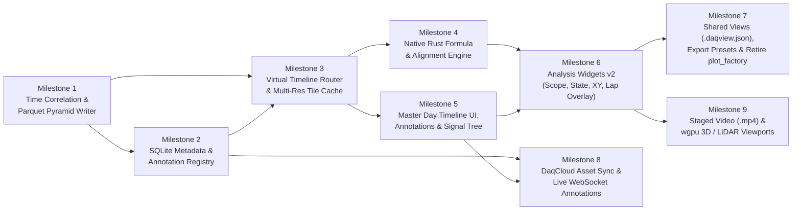

# PER DAQ Platform — Complete Step-by-Step Implementation Plan
### From Current Monorepo State (`0%`) to Production-Complete Option A v2 (`100%`)

**Date:** November 12, 2026  
**Companion Architecture Doc:** [PER_DAQ_Option_A_Master_Plan_v2.md](file:///home/millankumar/Documents/PER/daqstuff/monorepo_daqstuff_a/PER_DAQ_Option_A_Master_Plan_v2.md)  
**Target Workspace:** `daq/` (`daqcore`, `daqcli`, `daqapp`, `daqcloud`)

> [!IMPORTANT]
> **Core Engineering Mandate — Zero Attachment to Legacy Code:**  
> There is **no requirement to preserve backward compatibility with existing internal structs, traits, widgets, or crate layouts** in `daq/`. Wherever an existing module (`Session`, `RamCache`, `Timeline`, `TelemetryView`, `log_parse`, `daqcloud`, or hardcoded UI widgets like `BatteryVoltage`, `BatteryTemps`, `Dynamics`, `GgPlot`) does not cleanly fit the target architecture, **tear it down, rewrite it, or delete it outright** rather than bolting on adapters or workarounds. The sole objective is a clean, unified, maintainable final product.

---

## 0. Current Repository Baseline Audit (What to Keep vs. Tear Down / Rewrite)

Before writing new code, here is the exact inventory of what exists in `daq/` today and what we keep, rewrite from scratch, or delete:

| Component / File | Current State in Repo | Action in This Plan |
| :--- | :--- | :--- |
| `daqcore/src/superdbc/`, `can/`, `frame.rs` | Working CAN frame & SuperDBC decoder | **Keep & Refactor**; add first-class `SignalId` and columnar extraction helpers |
| `daqcore/src/can_thread/`, `connection.rs` | Working live slcan, UDP, and loopback drivers | **Keep** hardware drivers; update event/batch output to feed the new columnar router |
| `daqcore/src/firmware/`, `hil/` | Working bootloader & HIL state machines | **Keep** operational protocols |
| `daqcore/src/time.rs` | Basic `Time(i64)` wrapper | **Rewrite** into `time_model` with `ClockMapping` and `ClockConfidence` provenance |
| `daqcore/src/log_parse/` (`parse.rs`, `correlate.rs`, `table.rs`) | Reads `.log` files, chunks by tick jumps, fits GPS line, writes wide CSV (`table.rs`) | **Rewrite** into `daqcore::ingest`: add 3-tier clock correlation + auto-annotation detector; **delete `table.rs`** and replace with Parquet pyramid writer |
| `daqcore/src/cache.rs`, `timeline.rs`, `session.rs` | Frame-oriented `Vec<ParsedFrame>` in RAM (`RamCache`); rolling-only `Timeline` | **Tear down & Rewrite** into `VirtualTimelineRouter` + columnar `TileCache` + `LiveRingBuffer` (do not keep frame-by-frame UI iteration) |
| `daqapp/src/telemetry.rs` | `TelemetryView` slices raw `ParsedFrame` arrays on every frame render | **Tear down & Replace** with columnar/series-based `WorkspaceDataView` backed by `VirtualTimelineRouter` + `FormulaEngine` |
| `daqcloud/` (`migrations/`, `src/db/`, Diesel setup) | Row-per-sample `message_samples` & `signal_samples` tables | **Tear down & Rewrite**: delete existing migration and sample tables; replace with clean metadata/manifest/annotation registry |
| `daqapp/src/widgets.rs`, `ui/*` | Mix of operational tools (`Bootloader`, `Hil`, `SendUi`) and hardcoded/placeholder plots (`BatteryVoltage`, `BatteryTemps`, `Dynamics`, `GgPlot`, `Scope`) | **Keep** operational widgets (`Bootloader`, `Hil`, `SendUi`, `ViewerTable`); **tear down & replace** hardcoded plot widgets (`BatteryVoltage`, `BatteryTemps`, `Dynamics`, `GgPlot`, old `Scope`) with unified `Scope`, `StateLane`, `XYScatter`, and `GpsPlot` powered by presets |
| `daqapp/src/workspace.rs`, `app.rs` | Renders `egui_tiles::Tree<Widget>` with no serialization or view management | **Refactor / Rewrite** around serializable `.daqview.json` workspaces and repo-bundled subteam presets |
| `plot_factory/` (Python) | Standalone Python TOML plot & expression scripts | **Delete completely** once formulas, workspace presets, and export presets are in `daq/` |

---

## Dependency Additions Overview (`daq/Cargo.toml`)

Across the milestones below, add these workspace dependencies to `daq/Cargo.toml`:

```toml
[workspace.dependencies]
# Columnar storage & export
arrow = { version = "54", default-features = false, features = ["ipc"] }
parquet = { version = "54", default-features = false, features = ["arrow", "zstd"] }
rusqlite = { version = "0.33", features = ["bundled"] } # Lightweight shared local/cloud metadata & manifest queries
sha2 = "0.10"
uuid = { version = "1.11", features = ["v4", "serde"] }
base64 = "0.22"

# Networking & async background worker
reqwest = { version = "0.12", default-features = false, features = ["json", "stream", "rustls-tls"] }
tokio-tungstenite = "0.26"
```

---

## Visual Roadmap Dependency Graph



---

## Milestone 1: Time Correlation Upgrade & Canonical Parquet Partition Engine
**Goal:** Turn raw 1-minute SD card `.log` files into time-correlated, multi-resolution Parquet partitions (`full_res.parquet`, `overview_10hz.parquet`, `overview_1hz.parquet`, `states.parquet`, `manifest.json`).

### Step 1.1: Upgrade Clock Correlation with 3-Tier Fallback (`daq/daqcore/src/log_parse/correlate.rs`)
Currently, `time_correlate_chunk()` in [`correlate.rs`](file:///home/millankumar/Documents/PER/daqstuff/monorepo_daqstuff_a/daq/daqcore/src/log_parse/correlate.rs#L70) returns `correlation_fn: None` whenever an MCU boot epoch has no `gps_time` messages (leaving timestamps as raw `u32` ticks starting near `0`).
1. Modify `parse_log_files()` in [`parse.rs`](file:///home/millankumar/Documents/PER/daqstuff/monorepo_daqstuff_a/daq/daqcore/src/log_parse/parse.rs#L51) so each `ParsedMessage` retains a `source_file_idx` or extracted filename timestamp (`Option<i64>` parsed from `log-20YY-MM-DD--HH-MM-SS.log` written by [`sd_card.c`](file:///home/millankumar/Documents/PER/daqstuff/monorepo_daqstuff_a/firmware/source/daq/sd_card/sd_card.c#L39)) and file `mtime_unix_ms`.
2. Replace `Option<CorrelationFunction>` with an always-present `ClockMapping`:
   ```rust
   #[derive(Debug, Clone, Serialize, Deserialize)]
   pub enum ClockConfidence {
       GpsSynced { rms_error_ms: f64, point_count: usize },
       RtcEstimated,
       FileMtimeEstimated,
       ManualOffset,
   }

   #[derive(Debug, Clone, Serialize, Deserialize)]
   pub struct ClockMapping {
       pub slope: f64,
       pub intercept_ms: f64,
       pub confidence: ClockConfidence,
   }
   ```
3. In `time_correlate_chunk()`:
   - **Tier 1:** If valid `gps_time` messages exist, fit `slope` and `intercept_ms` via `linear_regression()` and set `ClockConfidence::GpsSynced`.
   - **Tier 2:** Else if the first `.log` file in the chunk matches `log-20(\d{2})-(\d{2})-(\d{2})--(\d{2})-(\d{2})-(\d{2})\.log`, compute `rtc_unix_ms` and set `slope = 1.0`, `intercept_ms = (rtc_unix_ms as f64) - (first_msg.timestamp as f64)`, `ClockConfidence::RtcEstimated`.
   - **Tier 3:** Else use the file's filesystem modification timestamp (`mtime_unix_ms`) with `ClockConfidence::FileMtimeEstimated`.

### Step 1.2: Build the Columnar Parquet Pyramid Writer (`daq/daqcore/src/storage/partition_writer.rs`)
Create a new module `daqcore::storage` that replaces the slow wide CSV generator (`log_parse/table.rs`):
1. Define a deterministic `SignalId` string format: `"{bus}.{node}.{message}.{signal}"` (e.g., `"VCAN.MAIN_MODULE.imu.accel_y_g"`).
2. For each correlated `BootEpoch` (and split into at most 15-minute sub-partitions if a boot epoch is multi-hour):
   - Compute SHA-256 over the source raw `.log` bytes to produce a deterministic `partition_id` (`epoch_{start_utc_ms}_{sha256_prefix}`).
   - **Write `full_res.parquet`:**
     - Schema: `(signal_id: Dictionary<Int32, Utf8>, utc_ms: Int64, ticks_ms: UInt32, value: Float64)` sorted by `(signal_id, utc_ms)` with `ZSTD` compression and row-group statistics enabled (so Parquet predicate pushdown can skip non-matching signals and time ranges without scanning the file).
   - **Write `overview_10hz.parquet` (100 ms buckets) and `overview_1hz.parquet` (1,000 ms buckets):**
     - Schema: `(signal_id: Dictionary<Int32, Utf8>, bucket_utc_ms: Int64, min_val: Float64, max_val: Float64, mean_val: Float64, count: UInt32)`.
     - Single-pass accumulator while iterating the sorted signal samples.
   - **Write `states.parquet` (Discrete Enum / Boolean Signals):**
     - Any signal in SuperDBC with `.choices().count() > 0` (enums/faults/states) is run-length encoded into intervals:
     - Schema: `(signal_id: Dictionary<Int32, Utf8>, start_utc_ms: Int64, end_utc_ms: Int64, raw_int: Int64, label: Utf8)`.
   - **Write `manifest.json`:**
     - Stores `partition_id`, `start_utc_ms`, `end_utc_ms`, `clock_mapping`, `superdbc_hash`, `raw_log_hashes`, and per-signal sample counts and `[min_utc_ms, max_utc_ms]`.

### Step 1.3: Auto-Annotation Detector During Import (`daq/daqcore/src/log_parse/auto_annotate.rs`)
While writing a partition, scan key vehicle signals to emit initial `Annotation` structs:
- **Motion Stint Detector:** Emit an interval annotation (`category: "driving_stint"`, `source: "auto"`) whenever wheel speed or GPS speed exceeds `1.0 m/s` for at least `5.0 s` (with a `10.0 s` debounce hysteresis so brief stops don't fragment a run).
- **Fault Detector:** Emit point/interval annotations (`category: "fault"`, `source: "auto"`) whenever a fault signal transitions from `0` to non-zero.

### Step 1.4: Upgrade `daqcli` with `import` Subcommand (`daq/daqcli/src/main.rs`)
Convert `daqcli` from a single-flag binary into a subcommand CLI (`clap::Subcommand`):
- `daqcli import --logs-dir <SD_PATH> --store-dir <ARCHIVE_DIR> --superdbc <DBC_PATH>`
- **Milestone 1 Verification:** Run `cargo test -p daqcore` and `cargo run -p daqcli -- import ...` on a sample `.log` folder; verify `full_res.parquet`, `overview_1hz.parquet`, `overview_10hz.parquet`, `states.parquet`, and `manifest.json` are generated and idempotent on re-import.

---

## Milestone 2: Local & Cloud Metadata Registry (`local_registry.sqlite` & `daqcloud` Schema)
**Goal:** Replace the row-per-sample `signal_samples` database schema with a fast, unified SQLite metadata & annotation registry used identically by local storage, USB drives, and `daqcloud`.

### Step 2.1: Create the Shared Registry Module (`daq/daqcore/src/storage/registry.rs`)
Create `daqcore::storage::Registry` backed by `rusqlite`:
```sql
CREATE TABLE IF NOT EXISTS track_days (
    id              TEXT PRIMARY KEY NOT NULL, -- e.g. "2026-11-12"
    title           TEXT NOT NULL,
    location        TEXT NOT NULL DEFAULT '',
    start_utc_ms    BIGINT NOT NULL,
    end_utc_ms      BIGINT NOT NULL
);

CREATE TABLE IF NOT EXISTS partitions (
    partition_id    TEXT PRIMARY KEY NOT NULL, -- deterministic content hash ID
    track_day_id    TEXT NOT NULL REFERENCES track_days(id),
    start_utc_ms    BIGINT NOT NULL,
    end_utc_ms      BIGINT NOT NULL,
    clock_confidence TEXT NOT NULL,            -- JSON of ClockMapping
    superdbc_hash   TEXT NOT NULL,
    relative_path   TEXT NOT NULL,             -- e.g. "partitions/epoch_.../"
    is_local        BOOLEAN NOT NULL DEFAULT 1,
    manifest_json   TEXT NOT NULL
);

CREATE TABLE IF NOT EXISTS annotations (
    id              TEXT PRIMARY KEY NOT NULL, -- UUID v4 or deterministic auto-ID
    track_day_id    TEXT NOT NULL REFERENCES track_days(id),
    name            TEXT NOT NULL,
    category        TEXT NOT NULL,             -- 'event', 'lap', 'driving_stint', 'fault', 'note'
    color           TEXT NOT NULL,
    start_utc_ms    BIGINT NOT NULL,
    end_utc_ms      BIGINT,                    -- NULL for point annotations
    author          TEXT NOT NULL DEFAULT 'local',
    source          TEXT NOT NULL DEFAULT 'manual', -- 'manual' | 'auto'
    notes           TEXT NOT NULL DEFAULT '',
    updated_at_ms   BIGINT NOT NULL,
    deleted         BOOLEAN NOT NULL DEFAULT 0
);

CREATE INDEX IF NOT EXISTS idx_partitions_time ON partitions(start_utc_ms, end_utc_ms);
CREATE INDEX IF NOT EXISTS idx_annotations_time ON annotations(start_utc_ms, end_utc_ms);
```
- **Crucial Rule:** `upsert_partition()` is idempotent by `partition_id`. Re-importing an SD card that still contains yesterday's `.log` files + 5 new `.log` files automatically skips already-registered partitions and only imports the new epoch!

### Step 2.2: Replace `daqcloud` Migration (`daq/daqcloud/migrations/`)
Replace [`daq/daqcloud/migrations/2026-10-16-161301-0000_create_daq_tables/up.sql`](file:///home/millankumar/Documents/PER/daqstuff/monorepo_daqstuff_a/daq/daqcloud/migrations/2026-10-16-161301-0000_create_daq_tables/up.sql) with the exact same `track_days`, `partitions`, `raw_assets`, and `annotations` tables (dropping `message_samples` and `signal_samples`).

- **Milestone 2 Verification:** Unit test `Registry` in `daqcore`: insert multiple partitions across a day, query overlapping partitions for `[t0, t1]`, insert/edit/soft-delete annotations, and verify `auto` annotations do not overwrite `manual` annotations on re-import.

---

## Milestone 3: The Virtual Timeline Router & Multi-Resolution Tile Cache
**Goal:** Give `daqapp` a single unified timeline across live UDP traffic and all historical Parquet partitions, with instant 60 FPS scrubbing across an entire 8-hour day.

### Step 3.1: Define the Columnar Series Types & Resolution Selector (`daq/daqcore/src/router/types.rs`)
```rust
#[derive(Debug, Clone, Copy, PartialEq, Eq)]
pub enum Resolution {
    Overview1Hz,   // Used when viewport span > 15 minutes
    Overview10Hz,  // Used when viewport span is 60s .. 15 minutes
    FullRes,       // Used when viewport span <= 60s (or during export)
}

#[derive(Debug, Clone)]
pub struct EnvelopePoint {
    pub utc_ms: i64,
    pub min: f64,
    pub max: f64,
    pub mean: f64,
}

#[derive(Debug, Clone)]
pub enum SignalSeries {
    Exact { timestamps_ms: Vec<i64>, values: Vec<f64> },
    Envelope(Vec<EnvelopePoint>),
}

#[derive(Debug, Clone)]
pub struct StateInterval {
    pub start_utc_ms: i64,
    pub end_utc_ms: i64,
    pub raw_int: i64,
    pub label: String,
}
```
Add a helper `Resolution::for_window_ms(window_ms: i64, plot_width_px: f32) -> Resolution`.

### Step 3.2: Build the Async Partition Reader & Tile Cache (`daq/daqcore/src/router/tile_cache.rs`)
1. When a track day is opened (or a new partition is imported), `TileCache` immediately loads `overview_1hz.parquet` and `states.parquet` for all partitions in that day into RAM (only a few megabytes for an entire 8-hour day).
2. For `Overview10Hz` and `FullRes`, `TileCache` caches `(partition_id, signal_id, Resolution) -> Arc<SignalSeries>` in an LRU map (bounded to e.g. 512 MB RAM).
3. If a widget requests `(signal_id, range, Resolution::FullRes)` and the overlapping partition's column isn't in `TileCache` yet:
   - `TileCache` immediately returns the resident `Overview1Hz` / `Overview10Hz` series as an instant zero-latency fallback so the UI thread **never blocks**, and
   - Enqueues a high-priority background read task on a worker thread that reads only the requested `signal_id` column from `full_res.parquet` and calls `egui::Context::request_repaint()` when ready (typically `< 5 ms` from local SSD).

### Step 3.3: Tear Down `session.rs` & `cache.rs` and Replace with `VirtualTimelineRouter` (`daq/daqcore/src/router/mod.rs`)
Delete [`session.rs`](file:///home/millankumar/Documents/PER/daqstuff/monorepo_daqstuff_a/daq/daqcore/src/session.rs) and rewrite [`cache.rs`](file:///home/millankumar/Documents/PER/daqstuff/monorepo_daqstuff_a/daq/daqcore/src/cache.rs) so we no longer store or iterate over `Vec<ParsedFrame>` for plotting. Instead, `VirtualTimelineRouter` owns:
- `live_buffer: LiveColumnBuffer` (stores per-signal `VecDeque<(i64, f64)>` columns for fast live plotting + a small latest-frame map for `ViewerTable` / CAN inspector)
- `tile_cache: TileCache` (historical Parquet partitions)
- `registry: Registry` (metadata & annotations)
- `timeline: MasterTimeline` (replaces [`timeline.rs`](file:///home/millankumar/Documents/PER/daqstuff/monorepo_daqstuff_a/daq/daqcore/src/timeline.rs) with global day bounds `[day_min_utc_ms, day_max_utc_ms]`, active viewport `[start, end, setpoint]`, and `collapse_idle_gaps: bool`)

**Source Precedence Rule in `VirtualTimelineRouter::query_signal(signal_id, range)`:**
1. Find all registered canonical SD `partitions` overlapping `range`.
2. Stitch their returned series across `[range.start, range.end]`.
3. If `range.end` extends past the latest canonical SD partition into the time range covered by `live_buffer`, append the live samples from `live_buffer` for `t > max_partition_end_utc_ms`.

- **Milestone 3 Verification:** Write an integration test in `daqcore` that loads two separate SD partitions (e.g. `10:00–10:15` and `10:45–11:00`) plus live frames at `11:05`, and verifies `VirtualTimelineRouter` seamlessly queries across the entire `10:00–11:06` span at `Overview1Hz`, `Overview10Hz`, and `FullRes`.

---

## Milestone 4: Native Vectorized Formula & Alignment Engine (`daqcore::analysis`)
**Goal:** Port the expression and derived-signal capabilities of `plot_factory/` into a native, fast Rust engine inside `daqcore`, with multi-rate alignment and lap-distance integration.

### Step 4.1: Expression Parser & AST Evaluator (`daq/daqcore/src/analysis/expr.rs`)
1. Implement a recursive-descent parser for mathematical expressions supporting:
   - Signal references: `VCAN.A_BOX.pack_stats.vbatt_adc` or derived channel IDs like `battery.voltage_v`
   - Arithmetic & comparisons: `+`, `-`, `*`, `/`, `^`, `>`, `<`, `==`
   - Built-in scalar functions: `abs(x)`, `min(a, b)`, `max(a, b)`, `clamp(x, lo, hi)`, `sqrt(x)`, `sin(x)`, `cos(x)`, `atan2(y, x)`
   - Built-in time-series window/calculus functions:
     - `derivative(sig, window_ms)` (savitzky-golay / central difference with smoothing window)
     - `integral(sig)` (trapezoidal integration over `[t_start..t_end]`, resetting across boot-epoch gaps)
     - `lowpass(sig, cutoff_hz)` (zero-phase or causal 1st-order Butterworth filter)
     - `rolling_mean(sig, window_ms)`
2. Perform topological sorting of derived channel definitions so `battery.power_w` can reference `battery.voltage_v` without order sensitivity, detecting cycles at load time.

### Step 4.2: Multi-Rate Temporal Aligner (`daq/daqcore/src/analysis/align.rs`)
When evaluating a binary expression `A + B` where signal `A` is sampled at 100 Hz and signal `B` is sampled at 500 Hz (or on a uniform export grid):
- Build the target timestamp vector `timestamps_ms: Vec<i64>` (either the union of timestamps from `A` and `B`, or a uniform grid `t_start, t_start + dt, ...`).
- Resample each input signal onto `timestamps_ms`:
  - **Continuous signals:** Linear interpolation between adjacent samples `(t0, v0)` and `(t1, v1)` **only if** `t1 - t0 <= max_staleness_ms` (default `250 ms`). If `t1 - t0 > max_staleness_ms` (e.g., an LV reboot or gap between runs), emit `f64::NAN` so plots break the line cleanly instead of drawing a fake diagonal line across a 30-minute break!
  - **Discrete enum/state signals:** Zero-order hold (previous value) within the same partition/boot epoch.

### Step 4.3: Distance-Along-Track Integrator (`daq/daqcore/src/analysis/distance.rs`)
Add `compute_distance_axis(speed_series: &SignalSeries, range: RangeInclusive<i64>) -> Vec<f64>`:
- Integrates vehicle velocity $s(t) = \int_{t_{\text{start}}}^{t} v(\tau)\,d\tau$ in meters so any signal $Y(t)$ in a lap or event annotation can be re-indexed as $Y(s)$ against distance $s \in [0, L]\text{ m}$.

### Step 4.4: Create `daq/config/derived_signals.json`
Migrate all derived signal definitions from [`plot_factory/configs/derived_signals/`](file:///home/millankumar/Documents/PER/daqstuff/monorepo_daqstuff_a/plot_factory/configs/derived_signals/battery.toml) (plus standard VD roll/pitch/heave/damper velocities) into `daq/config/derived_signals.json` and embed/load it automatically at `daqcore` startup.

- **Milestone 4 Verification:** Unit test `FormulaEngine` with multi-rate synthetic inputs (`100 Hz` voltage $\times$ `500 Hz` current with a 10-second gap in the middle) and verify exact numerical output and gap handling.

---

## Milestone 5: Master Day Timeline UI, Event Annotations & Signal Browser in `daqapp`
**Goal:** Replace the basic rolling-window slider in [`daq/daqapp/src/ui/timeline.rs`](file:///home/millankumar/Documents/PER/daqstuff/monorepo_daqstuff_a/daq/daqapp/src/ui/timeline.rs) with a full Track-Day Master Timeline, Annotation Editor, and drag-and-drop Signal Browser.

### Step 5.1: Upgrade `daq/daqapp/src/ui/timeline.rs` into the Master Timeline Bar
 Expand the bottom timeline panel into a two-lane interactive bar:
1. **Top Lane — Day Overview & Event Annotation Ribbon:**
   - Displays the entire active Track Day (`[day_start_utc_ms .. day_end_utc_ms]`).
   - Shades regions covered by **Canonical SD Partitions** (solid accent color), **Provisional Live UDP** (hatched/dashed accent), and **Idle Gaps** (dark gray; collapsed into a thin `// Idle //` divider when `"Fold Idle Gaps"` is checked).
   - Renders colored horizontal pills for all **Annotations** (`"Skidpad Run 1"`, `"Autocross Lap 2"`, `"IMD Fault"`).
   - **Interactions:**
     - **Single-click an Annotation pill:** Snaps the active viewport `[start, end]` to that event's exact `[start_utc_ms, end_utc_ms]`.
     - **Shift-click a second Annotation pill:** Activates **Comparison / Overlay Mode** between the selected events!
     - **Right-click / "+ Add Event" button (or `M` hotkey):** Drops a point bookmark at `setpoint` or creates a named interval annotation for the current selection in `Registry`.
2. **Bottom Lane — Active Window Scrub & Playhead Controls:**
   - Draggable zoom handles for `[start, end]`, play/pause playback at `0.1x / 0.5x / 1x / 2x` speed, step-frame buttons, and `"LIVE"` follow toggle.
   - Displays a **Clock Provenance Badge** (`GPS Synced ±1.2ms` | `RTC Estimated` | `Live UDP`).

### Step 5.2: Build the Unified Signal & Formula Browser (`daq/daqapp/src/ui/signal_browser.rs`)
Add a collapsible left-hand Signal Browser panel (alongside or inside `sidebar.rs`):
- Hierarchical tree of `Bus -> Node -> Message -> Signal (with Unit)` + a top-level **`Derived Signals (Formulas)`** folder.
- Instant fuzzy search bar (using `globset` / substring matching across signal names, descriptions, and units).
- **Drag-and-drop source (`ui.dnd_drag_source`):** Dragging any signal or formula onto a `Scope`, `StateLane`, `XYScatter`, or `GpsPlot` pane adds it to that widget.
- **"+ New Formula" button:** Opens an inline modal to define a new derived expression (`name`, `expression`, `unit`) with live syntax validation.

### Step 5.3: Upgrade `LogParser` Widget into an SD Card Import Manager (`daq/daqapp/src/ui/log_parser.rs`)
Update [`log_parser.rs`](file:///home/millankumar/Documents/PER/daqstuff/monorepo_daqstuff_a/daq/daqapp/src/ui/log_parser.rs) so selecting an SD card folder runs the Milestone 1 Parquet Partition + Auto-Annotation pipeline in a background thread with a progress bar, registers the partitions in `local_registry.sqlite`, and immediately refreshes the Master Timeline Bar without restarting `daqapp`.

- **Milestone 5 Verification:** Launch `daqapp`, import an SD card directory via the UI, see the whole day's partitions and auto-detected driving stints appear on the Master Timeline Bar, click a stint pill to zoom into it, and create/edit a manual annotation.

---

## Milestone 6: Engineering Analysis Widgets v2 (`Scope`, `StateLane`, `XYScatter`, `GpsPlot`)
**Goal:** Tear down legacy frame-slicing (`telemetry.rs`) and hardcoded single-purpose plot widgets (`ui/battery/`, `ui/dynamics.rs`, `ui/gg_plot.rs`), replacing them with unified, configurable AdvantageScope/Nominal-grade analysis widgets.

### Step 6.1: Tear Down `telemetry.rs` & Replace with `WorkspaceDataView`
Delete the frame-slicing [`telemetry.rs`](file:///home/millankumar/Documents/PER/daqstuff/monorepo_daqstuff_a/daq/daqapp/src/telemetry.rs) (`all_frames: &[ParsedFrame]`, `setpoint_frames: &[ParsedFrame]`) and replace it with `WorkspaceDataView`:
- Exposes direct access to `VirtualTimelineRouter` + `FormulaEngine` so widgets query pre-aligned, resolution-appropriate column slices by `SignalId`.
- Holds shared `hover_utc_ms: Option<i64>` (and `hover_distance_m: Option<f64>`):
  - Hovering over **any** `Scope`, `StateLane`, `XYScatter`, or `GpsPlot` widget draws a synchronized vertical crosshair (or highlight dot on XY/GPS maps) at that exact timestamp across **all** visible widgets simultaneously.
  - Clicking inside any plot sets the timeline `setpoint` to that timestamp.

### Step 6.2: Rewrite `Scope` for Multi-Axis, Envelope & Multi-Lap Overlays (`daq/daqapp/src/ui/scope.rs`)
Rewrite [`scope.rs`](file:///home/millankumar/Documents/PER/daqstuff/monorepo_daqstuff_a/daq/daqapp/src/ui/scope.rs) from scratch:
1. **Data source:** Query `VirtualTimelineRouter` + `FormulaEngine` by `SignalId`.
2. **Envelope rendering:** When the router returns `SignalSeries::Envelope` (zoomed out), draw a shaded `[min, max]` polygon band (`egui_plot::Polygon`) plus the `mean` line (`egui_plot::Line`); when zoomed in (`SignalSeries::Exact`), draw exact sample points/lines.
3. **Multiple Y-Axes by Unit:** Group plotted signals by their `unit` (`"V"`, `"A"`, `"mm"`, `"deg/s"`) using `egui_plot`'s multi-axis support (`y_axis_label` / linked axis groups), and display live cursor values + `[min, max, mean]` statistics in the legend header.
4. **X-Axis Mode Selector (`UTC Time` | `Elapsed Event Time (s)` | `Track Distance (m)`):**
   - When two or more Event/Lap annotations are selected on the Master Timeline, `Scope` overlays both runs on the same plot (using solid vs. dashed lines) aligned by either elapsed time $\Delta t$ or integrated distance $s$!

### Step 6.3: Discrete Enum & Fault `StateLane` Widget (`daq/daqapp/src/ui/state_lane.rs`)
Create `Widget::StateLane` that queries `states.parquet` (plus live enum transitions) and renders horizontal colored state bars (like AdvantageScope's discrete state rows) for signals like `rtd_state`, `BMS_state`, `inverter_enable`, and `active_faults`.

### Step 6.4: Unified `XYScatter` Widget & Removal of Legacy Hardcoded Widgets (`daq/daqapp/src/ui/xy_scatter.rs`)
Delete [`gg_plot.rs`](file:///home/millankumar/Documents/PER/daqstuff/monorepo_daqstuff_a/daq/daqapp/src/ui/gg_plot.rs), [`dynamics.rs`](file:///home/millankumar/Documents/PER/daqstuff/monorepo_daqstuff_a/daq/daqapp/src/ui/dynamics.rs), and [`ui/battery/`](file:///home/millankumar/Documents/PER/daqstuff/monorepo_daqstuff_a/daq/daqapp/src/ui/battery), replacing them with a general `Widget::XYScatter` + repo-bundled workspace presets:
- Allows picking **any** signal/formula for `X`, **any** signal/formula for `Y`, and an optional signal/formula for **Color Gradient (`Z`)** (e.g., `yaw_rate` vs. `accel_y` colored by `speed_mps`, or `pack_voltage` vs. `pack_temp` colored by `pack_power`).
- Highlights the trail around the current `setpoint` cursor with a bright comet marker.
- Provide 1-click preset shortcuts in the Command Palette (`"G-G Diagram"`, `"Handling Understeer"`, `"Battery Pack Overview"`) that spawn pre-configured `XYScatter` / `Scope` layouts rather than maintaining separate hardcoded Rust widget files.

### Step 6.5: Colored `GpsPlot` Map (`daq/daqapp/src/ui/gps_plot.rs`)
Upgrade [`gps_plot.rs`](file:///home/millankumar/Documents/PER/daqstuff/monorepo_daqstuff_a/daq/daqapp/src/ui/gps_plot.rs) so the GPS breadcrumb trajectory can be colored by **any** selected signal or formula (e.g., speed, brake pressure, lateral G, yaw rate—replacing all the `*_vs_gps.toml` configs in `plot_factory/`) and draws the live `setpoint` car marker synchronized with the linked plot crosshair.

- **Milestone 6 Verification:** Open `Scope`, `StateLane`, `XYScatter`, and `GpsPlot` side-by-side in `daqapp`; drag signals and formulas into them; verify 60 FPS linked-crosshair scrubbing and two-lap distance-aligned overlay.

---

## Milestone 7: Shared Views (`.daqview.json`), Signal Export Presets & Retirement of `plot_factory`
**Goal:** Make saving/sharing complete workspace views and exporting subteam signal bundles (`"VD"`, `"Aero"`, `"Powertrain"`) effortless via repo-tracked JSON files, and delete `plot_factory/`.

### Step 7.1: Serialize Workspaces & Views (`daq/daqapp/src/workspace_io.rs`)
1. Derive `serde::Serialize` and `serde::Deserialize` on the configuration state of all analysis widgets (`ScopeConfig`, `StateLaneConfig`, `XYScatterConfig`, `GpsPlotConfig`, etc.) and `egui_tiles::Tree` layout structure.
2. Define the `WorkspaceView` struct (matching the `.daqview.json` schema in `PER_DAQ_Option_A_Master_Plan_v2.md` Section 4.3):
   - `name: String`
   - `time_context: Option<SavedTimeContext>` (`start_utc_ms`, `end_utc_ms`, `setpoint_utc_ms`, `compared_annotation_ids`)
   - `custom_formulas: Vec<DerivedSignalDef>`
   - `tile_layout` + `widgets`
3. Add UI controls in `daqapp`'s top bar / sidebar / Command Palette (`CMD+P`):
   - **"Export View to File (`.daqview.json`)"** & **"Copy View Share String to Clipboard"**
   - **"Import View..."** with a checkbox: `[x] Jump to saved time range (uncheck to keep current time window)`
   - **"Workspace Presets"** dropdown populated from `daq/config/workspace_presets.json` (`"VD Handling & Suspension"`, `"Powertrain & Accumulator"`, `"Aero Ride Height"`, `"Trackside Live Debug"`).

### Step 7.2: Repo-Tracked Signal Export Presets (`daq/config/export_presets.json` & `daqcore::export`)
1. Create `daq/config/export_presets.json` with subteam presets (`"vd"`, `"aero"`, `"powertrain_thermals"`, `"controls"`, `"raw_all"`), supporting glob patterns (`"VCAN.MAIN_MODULE.shock_pots.*"`) and derived signal IDs (`"battery.power_w"`).
2. Implement `daqcore::export::export_dataset()`:
   - Accepts: `range: RangeInclusive<i64>`, `signal_patterns: &[String]`, `sampling_mode: SamplingMode` (`UniformGridHz(f64)` or `SparseRaw`), and `format: ExportFormat` (`Parquet`, `Csv`, `MatlabMat`).
   - Uses `VirtualTimelineRouter` (at `Resolution::FullRes`) + `FormulaEngine` + `align.rs` to materialize the synchronized table and write it to disk.
3. Build the **3-Click Export Modal (`daq/daqapp/src/ui/export_modal.rs`)** in `daqapp`:
   - Pick **Time Range** (`Current Viewport` or an `Event Annotation` dropdown).
   - Pick **Subteam Preset** (`Vehicle Dynamics`, `Aero`, `Powertrain & Thermals`).
   - Pick **Format** (`Parquet`, `CSV`, `MATLAB`) and click **Export**.
4. Expose the same exporter in `daqcli`:
   ```bash
   daqcli export --store-dir ./archive --event "Skidpad Run 2" --preset vd --format parquet -o run2_vd.parquet
   ```

### Step 7.3: Retire `plot_factory/`
Once all 29 plot configs in `plot_factory/configs/` are represented in `daq/config/derived_signals.json`, `daq/config/workspace_presets.json`, and `daq/config/export_presets.json`:
- Remove `plot_factory/` and its Python dependencies from `requirements.txt`.

- **Milestone 7 Verification:** Export a view from `daqapp` to `test.daqview.json`, clear the workspace, re-import `test.daqview.json`, and confirm all panes, split ratios, formulas, and the exact `[start, end, setpoint]` time window restore identically. Export the `"vd"` preset for a 30-second run to Parquet/CSV and verify column headers, units, and interpolated values in Python/MATLAB.

---

## Milestone 8: `daqcloud` Asset Server, Resumable Sync & Real-Time Annotations
**Goal:** Turn the stub `daqcloud` server into a durable archive for raw `.log` files, `.parquet` partitions, and real-time shared team annotations.

### Step 8.1: Implement `daqcloud` HTTP + WebSocket API (`daq/daqcloud/src/`)
In `daq/daqcloud/src/main.rs`, replace the placeholder `"daqcloud\n"` route with an Axum router providing:
1. **`GET /api/v1/catalog`** — Returns all `track_days` and `partitions` manifests (`manifest_json`) so any connected `daqapp` immediately sees every track day and time range on the server without downloading the Parquet files upfront.
2. **`HEAD / PUT / GET /api/v1/partitions/{partition_id}/{filename}`** — Uploads and downloads immutable partition files (`overview_1hz.parquet`, `overview_10hz.parquet`, `full_res.parquet`, `states.parquet`, and raw `.log` archives) with checksum verification and HTTP `Range` support.
3. **`GET / POST / PATCH / DELETE /api/v1/annotations`** — CRUD endpoints for point and interval annotations, backed by `cloud_registry.sqlite`.
4. **`GET /api/v1/ws`** — WebSocket endpoint that broadcasts newly created/edited annotations and newly uploaded partition manifests to all connected `daqapp` clients in real time.

### Step 8.2: Background Cloud Sync Worker in `daqapp` (`daq/daqcore/src/storage/cloud_sync.rs`)
Add a non-blocking background Tokio task in `daqcore`:
- **When connected to `daqcloud` (or a pit-lane LAN `daqcloud` instance):**
  1. Immediately fetches the catalog (`GET /api/v1/catalog`) and downloads the tiny `overview_1hz.parquet` + `states.parquet` files for the selected Track Day so the whole day's timeline is immediately navigable.
  2. When the user zooms into a time window `[t0, t1]` whose `full_res.parquet` partition is not yet cached locally (`is_local == false`), downloads that partition into the local `partitions/` folder, flips `is_local = true` in `local_registry.sqlite`, and populates `TileCache`.
  3. Automatically uploads any newly imported local SD partitions to `daqcloud` in the background.
  4. Syncs offline-created local annotations with `daqcloud` using last-write-wins `updated_at_ms` timestamps and listens on `/api/v1/ws` for live teammate annotations.

- **Milestone 8 Verification:** Start `daqcloud` locally; import an SD card in `daqapp` Instance A; verify Instance B (pointed at the same `daqcloud` with an empty local folder) automatically sees the Track Day on its timeline, streams the `1 Hz` overview, downloads `full_res.parquet` on zoom-in, and sees annotations created by Instance A within `< 100 ms`.

---

## Milestone 9: Staged Multimodal Viewports (Video `.mp4` & `egui_wgpu` 3D / LiDAR)
**Goal:** Complete the multimodal architecture so camera video, 3D vehicle attitude/suspension, and LiDAR point clouds plug directly into the unified timeline.

### Step 9.1: Time-Synchronized Video Widget (`daq/daqapp/src/ui/video_player.rs`)
1. In `daqcore::storage`, add media attachment support to partitions (`media_manifest.json` + `video_index.parquet` mapping `frame_idx -> correlated_utc_ms`).
2. Implement `Widget::VideoPlayer`:
   - Observes `view.view_time()` (`setpoint` on the unified timeline).
   - Binary-searches `video_index.parquet` for the frame matching `setpoint_utc_ms`.
   - Decodes the frame on a background worker thread and updates an `egui::TextureHandle` rendered inside the widget pane, overlaid with timestamp and clock-sync provenance.

### Step 9.2: Native `egui_wgpu` 3D Pose & LiDAR Viewport (`daq/daqapp/src/ui/spatial_3d.rs`)
1. Implement `Widget::Spatial3D` using `eframe::egui_wgpu::Callback`:
   - **Orbit / Follow 3D Camera:** Mouse drag to orbit, scroll to zoom, toggle between `"Track-Fixed"` and `"Car-Fixed"` reference frames.
   - **3D Vehicle Wireframe & Suspension Visualizer:** Driven directly by correlated CAN/formula channels (`roll_deg`, `pitch_deg`, `yaw_deg`, `fl/fr/rl/rr_shock_mm`, `steering_angle_deg`) so Vehicle Dynamics can watch the car's 3D attitude, tire load vectors, and suspension compression at the `setpoint` cursoreven before a physical LiDAR sensor is mounted!
   - **LiDAR Point-Cloud Renderer:** Instanced WGSL point shader that renders compressed `(x, y, z, intensity)` scans from `lidar_scans.zst` / `.mcap` indexed by `correlated_utc_ms`.
2. **Optional External Rerun Bridge (`daqcli rerun-bridge` / UI button):**
   - Add a 100-line helper that exports the active `[start..end]` window's Arrow/Parquet + MCAP slices to a temporary `.rrd` or Rerun gRPC stream for any future Autonomy developer who wants Rerun's specialized SLAM/bounding-box inspector without affecting `daqapp`.

- **Milestone 9 Verification:** Scrub the Master Timeline Bar across a run and verify the 3D car wireframe pitches/rolls/steers in sync with the `Scope` crosshairs and `VideoPlayer` frame at 60 FPS.

---

## Summary Checklist: Definition of "100% Complete"

- [ ] **M1:** SD `.log` files stitch across 1-minute boundaries, correlate via 3-tier clock hierarchy (GPS → STM32 RTC → Mtime), auto-detect driving stints/faults, and write `full_res`, `overview_10hz`, `overview_1hz`, and `states` Parquet partitions.
- [ ] **M2:** `local_registry.sqlite` and `daqcloud` share the clean metadata/manifest/annotation schema (`signal_samples` relational table removed).
- [ ] **M3:** `VirtualTimelineRouter` + `TileCache` seamlessly route between canonical SD partitions and the live UDP ring buffer, serving 8-hour `1 Hz` overviews in `< 1 ms` and loading `full_res` columns asynchronously on zoom.
- [ ] **M4:** `daqcore::analysis` evaluates derived signal formulas (`daq/config/derived_signals.json` + inline user formulas) with staleness-aware multi-rate alignment and lap-distance integration.
- [ ] **M5:** `daqapp` Master Day Timeline Bar renders whole-day activity, folds idle gaps, displays/edits Event & Fault Annotations, and pairs with a drag-and-drop Signal & Formula Browser.
- [ ] **M6:** `Scope`, `StateLane`, `XYScatter`, and `GpsPlot` render with linked crosshairs across all panes, multi-unit Y-axes, and multi-lap/event overlays (by time or distance).
- [ ] **M7:** Workspaces export/import via `.daqview.json` (layout + widgets + formulas + time range), subteam signal bundles export in 3 clicks via `daq/config/export_presets.json` (`"vd"`, `"aero"`, `"powertrain_thermals"`), and `plot_factory/` is deleted.
- [ ] **M8:** `daqcloud` serves immutable partitions on demand and syncs live team annotations over WebSockets, with full offline/USB fallback.
- [ ] **M9:** Time-synced `.mp4` video and `egui_wgpu` 3D vehicle pose / LiDAR viewports scrub in lockstep with the Master Timeline playhead.
