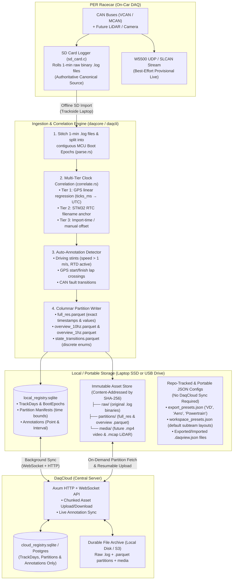
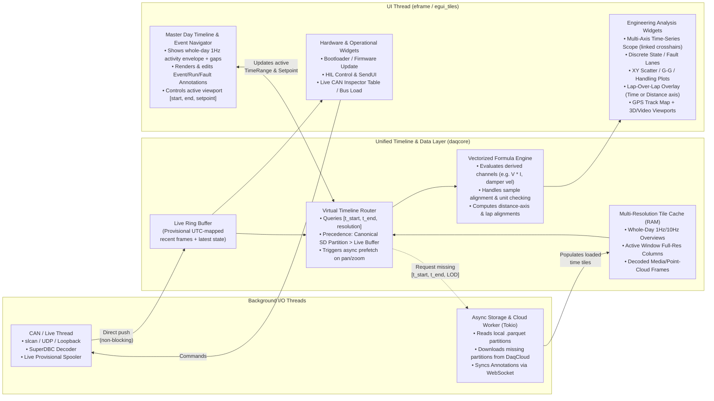
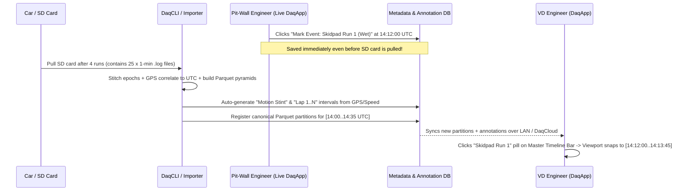
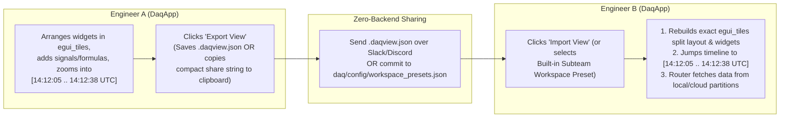

# PER DAQ Platform — Option A Master Plan v2
### Single Unified Timeline, Columnar Storage, and Multimodal (LiDAR/Video) Evaluation

**Date:** November 12, 2026  
**Step-by-Step Implementation Guide:** [PER_DAQ_Implementation_Roadmap.md](file:///home/millankumar/Documents/PER/daqstuff/monorepo_daqstuff_a/PER_DAQ_Implementation_Roadmap.md)  
**Historical Archive (Out of Date):** Supersedes [`archive/DaqApp Master Plan v1.drawio.png`](file:///home/millankumar/Documents/PER/daqstuff/monorepo_daqstuff_a/archive/DaqApp%20Master%20Plan%20v1.drawio.png), [`archive/PER_DAQ_Architecture_Decision_Handoff.md`](file:///home/millankumar/Documents/PER/daqstuff/monorepo_daqstuff_a/archive/PER_DAQ_Architecture_Decision_Handoff.md), and the `SignalSamples` relational schema in `daqcloud_tables.drawio.png` (which are retained for background context only and are fully out of date).

> [!IMPORTANT]
> **Zero Attachment to Existing Code:** Any existing crate, module, struct, database migration, or widget in `daq/` (`Session`, `RamCache`, `Timeline`, `TelemetryView`, `log_parse`, `daqcloud`, or hardcoded UI widgets) may be torn down, refactored, or rewritten from scratch to achieve this architecture cleanly without legacy workarounds.

---

## 1. Executive Summary: What Changed from Master Plan v1 to v2?

The original `DaqApp Master Plan v1.drawio.png` had the right **high-level goal**—decoupling UI widgets from raw live CAN traffic so the user could scrub across a **single unified timeline**—but its **storage and data-flow mechanism** had three critical flaws:

1. **Row-per-sample SQLite replication (`SignalSamples`) doesn't scale or travel well:** Storing every decoded CAN signal sample as an individual relational row (`id, message_sample_id, signal_def_id, value`) and syncing partial time ranges between a cloud DB and a local SQLite DB requires complex cache-invalidation/merge logic and creates massive index overhead.
2. **Physical files and MCU boot epochs do not equal "Events":** On the car, `firmware/source/daq/sd_card/sd_card.c` rolls a new `.log` file every 60 seconds, and `ticks_ms` (`xTaskGetTickCount()`) resets whenever LV power cycles. A single track day produces dozens of arbitrary 1-minute `.log` files and multiple boot epochs. Engineers cannot open "Run 3" as a file—they need **one continuous wall-clock timeline** where runs, laps, and faults are **time-range annotations** layered on top.
3. **Subteam analysis workflows were forced outside the app:** Vehicle Dynamics, Mechanical, Aero, and Powertrain engineers previously had to fall back to external Python (`plot_factory/`) and MATLAB scripts because `daqapp` lacked derived math channels, multi-axis plots, discrete state lanes, XY scatter plots (e.g., G-G diagrams, yaw rate vs. lateral acceleration), lap-over-lap overlays, shareable views, and preset-driven signal exports. **In Master Plan v2, `plot_factory/` is retired—all workflows happen natively through `daqapp` (and `daqcli`).**

### Key Architectural Shifts in Master Plan v2 (Option A)

| Layer | Master Plan v1 (Original) | Master Plan v2 (Updated Option A) |
| :--- | :--- | :--- |
| **Canonical Decoded Storage** | Row-per-sample relational tables (`MessageSamples`, `SignalSamples`) in Cloud & Local SQLite | **Immutable Columnar Parquet Partitions** (full-res + pre-computed `1 Hz` / `10 Hz` overview pyramids) |
| **Role of SQLite** | Stores every individual signal sample + metadata | **Metadata, Provenance & Annotations Only** (TrackDays, BootEpochs, Partition Manifests, Annotations) |
| **Single Unified Timeline** | Queries raw samples from local SQLite into `RamCache` on every pan/zoom | **Multi-Resolution Virtual Timeline (LOD)**: instant whole-day scrubbing via `1 Hz` overview pyramids; on-demand full-res partition reads when zoomed in |
| **Live vs. Historical Merge** | Mutates local SQLite DB to backfill around live data | **Zero-mutation precedence routing**: `VirtualTimelineRouter` reads canonical SD partitions where available and falls back to the live ring buffer for recent un-imported data |
| **Events / Runs / Laps** | Implicitly tied to `Uploads` (`upload_id`) | **First-class time intervals (`start_utc_ms..end_utc_ms`)** on the global timeline (both auto-detected and human-annotated) |
| **Derived Math & XY Plots** | Relied on external Python (`plot_factory/`) or hardcoded widgets | **`plot_factory` retired; 100% native in `daqapp`/`daqcore`** with vectorized formulas, unit propagation, distance axes, and lap overlays |
| **Shared Views & Export Presets** | Hardcoded widget list; manual CSV dumps | **Exportable/Importable View JSONs** (widget tree + layout + time range) and **repo-tracked JSON Signal Export Presets** (`"VD"`, `"Aero"`, etc.)—no `daqcloud` sync needed |
| **LiDAR / 3D / Video** | Not addressed | **Time-indexed native media containers** (`.mp4` + frame index, `.mcap` / chunked point clouds) synchronized to the same `utc_ms` timeline via `wgpu` & async media decode |

---

## 2. Master Plan v2: Visual System Architecture

### 2.1 End-to-End Data Flow (Car → SD/Live → Local DaqApp ↔ DaqCloud)



---

### 2.2 Inside `DaqApp` v2 (Direct Replacement for `DaqApp Master Plan v1.drawio.png`)

Compare this directly with the right half of `DaqApp Master Plan v1.drawio.png`:



---

## 3. Deep Dive: How the "Single Unified Timeline" Works

### 3.1 Solving the "Unchunked 1-Minute Log Files" Problem

Because the car logs arbitrary 1-minute `.log` files (`log-2026-11-12--14-01-00.log`, `log-2026-11-12--14-02-00.log`, ...) and resets `ticks_ms` to `0` on every LV reboot, **files are treated purely as raw transport containers**.

During import (`daqcli` or inside `daqapp`), raw `.log` files go through a 3-stage normalization pipeline:

1. **Contiguous Boot-Epoch Stitching (`parse.rs`):**
   - Adjacent 1-minute `.log` files with monotonically increasing `ticks_ms` are stitched into a single contiguous **Boot Epoch** (`RecordingSegment`).
   - Whenever `ticks_ms` jumps backward (MCU power cycle) or jumps forward by `> MAX_JUMP_MS`, a new `BootEpoch` is started.
2. **Multi-Tier Wall-Clock Correlation (`correlate.rs`):**
   - Every sample inside a `BootEpoch` keeps its raw `ticks_ms: u32`, AND gets mapped to a 64-bit Unix UTC timestamp (`utc_ns: i64` or `utc_ms: i64`) via a stored `ClockMapping`:
     $$\text{utc\_ms} = \text{round}(\text{slope} \times \text{ticks\_ms} + \text{intercept\_ms})$$
   - **What if a Boot Epoch has no GPS lock?** (e.g., short paddock power-on or indoor shop test):
     - **Tier 1 (`GpsSynced`):** Fit `slope` and `intercept_ms` via linear regression over `gps_time` CAN messages (sub-millisecond accuracy).
     - **Tier 2 (`RtcEstimated`):** If no `gps_time` messages exist in the epoch, extract the STM32 hardware RTC timestamp from the first `.log` filename (`log-YYYY-MM-DD--HH-MM-SS.log` generated by `sd_card.c`) as `intercept_ms` with `slope = 1.0`.
     - **Tier 3 (`ImportEstimated` / `ManualOffset`):** If RTC wasn't set (`log-0.log`), place the epoch at the SD-card file modification time (or allow the user to drag the epoch bar on the master timeline) and badge it as `Unverified Clock`.
   - **Result:** Every single sample from the entire track day now lives on **one shared, monotonic 64-bit coordinate axis (`utc_ms`)** without ever losing its original `ticks_ms` or clock-confidence metadata.

---

### 3.2 Multi-Resolution Pyramid (How You Scrub 8 Hours at 60 FPS)

Why did the v1 plan struggle when zooming out to a whole track day? Because querying millions of raw CAN samples across an 8-hour window freezes the UI and blows up memory.

In Option A v2, whenever a `BootEpoch` is imported, the parser writes **three immutable Parquet files** for that epoch (or 10-minute slice):

```text
partitions/epoch_20261112_140012_a8f3/
├── manifest.json            # Epoch metadata, clock mapping, signal list, SHA-256 of raw .log files
├── full_res.parquet         # Exact (utc_ms, ticks_ms, signal_id, value) sorted by (signal_id, utc_ms)
├── overview_10hz.parquet    # 100ms buckets: (bucket_utc_ms, signal_id, min_val, max_val, mean_val, count)
├── overview_1hz.parquet     # 1000ms buckets: (bucket_utc_ms, signal_id, min_val, max_val, mean_val, count)
└── states.parquet           # Run-length encoded discrete state intervals: (signal_id, start_utc_ms, end_utc_ms, enum_val)
```

Look at what this does for memory and speed across a **full 8-hour track day** (`28,800` seconds) with **200 signals**:

| Zoom Level in UI | Time Span Visible | File Queried by `VirtualTimelineRouter` | Points per Signal Rendered | Query / Render Latency |
| :--- | :--- | :--- | :--- | :--- |
| **Whole Track Day** | 8 hours (`28,800 s`) | `overview_1hz.parquet` (always resident in RAM) | ~2,000–5,000 min/max buckets | **< 1 ms (60+ FPS instant scrub)** |
| **Stint / Session View** | 15 minutes (`900 s`) | `overview_10hz.parquet` | 9,000 min/max buckets | **< 2 ms** |
| **Lap / Corner Analysis** | 30 seconds (`30 s`) | `full_res.parquet` (fetched only for active `[t0, t1]`) | 3,000–30,000 exact samples | **< 5 ms local / cached** |
| **Discrete States / Faults** | Any zoom level | `states.parquet` (run-length intervals) | ~10–500 transitions all day | **< 1 ms** |

Because `min_val` and `max_val` are preserved in every `1 Hz` and `10 Hz` bucket, **even brief 5 ms voltage spikes or fault transients are never hidden when zoomed out to the 8-hour view**—the plot draws the shaded `[min, max]` envelope band and sharpens into exact sample points as you zoom in!

---

### 3.3 How "Events" Work on the Single Unified Timeline

Since raw `.log` files don't represent events, **Events are first-class interval objects (`Annotations`)** stored in the metadata registry (`local_registry.sqlite` ↔ `daqcloud`) and rendered as interactive colored lanes at the top of the Master Timeline Bar:



**Three types of timeline annotations coexist cleanly:**
1. **Manual / Live Pit-Wall Bookmarks:** Created with one hotkey during live UDP monitoring or post-run review (`"Skidpad Run 2 - stiff ARB"`, `"Weird inverter derate here"`). Because they are stored by `utc_ms`, a note taken live on the pit wall automatically aligns with the high-resolution SD card data imported 15 minutes later!
2. **Auto-Generated Driving Stints & Laps:** During SD import, an analyzer pass automatically emits interval annotations whenever the car is in Ready-to-Drive (`RTD`) / moving (`speed > 1.0 m/s`), and splits laps whenever the GPS trajectory crosses a start/finish line gate.
3. **Dead-Time Gap Folding:** If the car sits powered off in the paddock from `12:00 PM` to `1:45 PM`, the Master Timeline Bar knows no partition covers that interval. A single **"Collapse Idle Gaps"** toggle in the timeline UI visually compresses empty intervals into a thin `// 1h 45m idle //` divider so 95% of your horizontal screen space is spent on actual driving!

---

### 3.4 Seamless Live-to-Historical Reconciliation (Without Database Mutation)

In the v1 diagram, merging live UDP traffic with historical SQLite data was a major source of complexity. In v2, **`LiveRingBuffer` and `PartitionStore` never mutate each other**:

1. While the car is running, incoming UDP frames are timestamped (using GPS/RTC correlation if available, or laptop `SystemTime::now()` UTC) and pushed into `LiveRingBuffer` (plus an optional local `provisional_live.parquet` spool file).
2. When any widget asks `VirtualTimelineRouter` for signal $S$ over $[t_{\text{start}}, t_{\text{end}}]$:
   - For any sub-interval covered by an imported **Canonical SD Partition**, the router returns data from the SD Partition (and draws a solid status bar: `Source: Canonical SD`).
   - For any sub-interval not yet covered by an SD Partition (e.g., the car is currently on track), the router returns data from `LiveRingBuffer` (and draws a dashed status bar: `Source: Live UDP (Provisional)`).
3. The moment an SD card is imported locally or uploaded to `daqcloud`, the router simply switches that time range to read the new SD partition. Zero deduplication bugs, zero database locks, and zero overwritten samples.

---

## 4. Subteam Analysis, Shared Workspaces & Preset Signal Export (Retiring `plot_factory`)

> **Explicit Non-Reliance on `plot_factory`:**  
> `plot_factory/` was an offline Python workaround created because `daqapp` lacked derived signals, XY plots, and saved views. **In Master Plan v2, `plot_factory/` is deprecated and retired.** Every analysis workflow—evaluating derived math channels, viewing standard subteam plots, sharing a view with a teammate, and exporting signal bundles for MATLAB/Python—runs natively through `daqapp` (and `daqcli`).

### 4.1 Native Derived Signals & Vectorized Expressions (`daqcore::analysis`)

CAN signals arrive in different messages at different rates (e.g., `vbatt_adc` at 100 Hz vs. `pack_current` at 500 Hz, or `steering_angle` vs. `yaw_rate`). Standard derived channels live in a repo-tracked config (`daq/config/derived_signals.json` or `.toml`), and users can also define custom formulas directly in `daqapp`:

```json
{
  "id": "vd.understeer_gradient",
  "label": "Understeer Gradient",
  "expression": "steering_angle_deg / 4.5 - (1.53 * yaw_rate_deg_s / max(speed_mps, 2.0))",
  "unit": "deg"
}
```

The `FormulaEngine` evaluates the AST over `[utc_ms, f64]` column slices using explicit **Temporal Alignment Semantics**:
- **Continuous physical signals (`f64`):** Aligned onto the union timestamp grid (or highest-rate input grid) using **linear interpolation** with a configurable `max_staleness_ms` (e.g., 200 ms—so a 20-minute gap between runs never linearly interpolates across lunch!).
- **Discrete state signals (`enum` / `bool`):** Aligned using **previous-value hold (zero-order hold)** within the same Boot Epoch.
- **Calculus / Window operators:** Built-in `derivative(sig, smooth_ms)`, `integral(sig, reset_on_event)`, `lowpass(sig, cutoff_hz)`, `rolling_mean(sig, window_ms)`.

---

### 4.2 Coordinate Systems Beyond UTC Time (What Vehicle Dynamics Needs)

Because `VirtualTimelineRouter` and `FormulaEngine` output strongly typed columnar series, plots are not restricted to plotting against `utc_ms`:

1. **Global Wall-Clock Time (`utc_ms`):** Default unified timeline view across the day.
2. **Event / Lap Elapsed Time ($\Delta t = t - t_{\text{event\_start}}$):** Select two or more annotations (e.g., `"Autocross Run 1"` and `"Autocross Run 3"`) and overlay them from $t = 0.0\text{ s}$ to $t = 65.0\text{ s}$ on the same plot.
3. **Distance Along Lap ($s \in [0, L]\text{ meters}$):** Automatically integrate vehicle velocity $s(t) = \int_{t_0}^{t} v(\tau)\,d\tau$ within each lap/event so Vehicle Dynamics can overlay braking points and shock travel at exact track positions ($s = 245\text{ m}$ into the lap) even when one lap is faster than the other!
4. **Signal-vs-Signal XY Scatter (`GgPlot`, `Handling`, `Powertrain`):** Plot any channel/formula $Y(t)$ against any channel/formula $X(t)$, colored by a third channel $Z(t)$ over the active timeline window $[t_{\text{start}}, t_{\text{end}}]$, with the live time cursor (`setpoint`) highlighted as a moving crosshair on the XY curve.

---

### 4.3 Shared Workspaces / Views (Export, Import & Repo Presets — No `DaqCloud` Sync Needed)

A **Workspace (View)** in `daqapp` is a lightweight, human-readable JSON document (`.daqview.json` or a compact clipboard share string) that serializes the entire UI state:
1. **`egui_tiles` Layout Tree:** Exact split container positions/ratios, tab groups, and active tabs.
2. **Widget List & Configurations:** Every open widget (`Scope`, `XYScatter`, `StateLane`, `GpsMap`, etc.), which raw/derived signals are plotted on which Y-axis, colors, and coordinate mode (`Time`, `LapElapsed`, `Distance`).
3. **Custom Inline Formulas:** Any ad-hoc derived expressions created in that view so the recipient's `daqapp` can compute them immediately.
4. **Timeline Window (`time_context`):** Either `Live` (rolling window) OR a pinned historical window (`start_utc_ms`, `end_utc_ms`, `setpoint_utc_ms`, and optional `annotation_id` / `comparison_annotation_ids`).



#### Example Serialized View (`.daqview.json`)

```json
{
  "version": 1,
  "name": "Skidpad Run 2 — Front Left Shock Bottoming Investigation",
  "time_context": {
    "mode": "pinned_range",
    "start_utc_ms": 1794507125000,
    "end_utc_ms": 1794507158000,
    "setpoint_utc_ms": 1794507141250
  },
  "custom_formulas": [
    {
      "id": "custom.fl_damper_vel_mps",
      "expression": "derivative(VCAN.MAIN_MODULE.shock_pots.fl_mm / 1000.0, 20)",
      "unit": "m/s"
    }
  ],
  "tile_layout": {
    "root_split": "horizontal",
    "shares": [0.65, 0.35],
    "children": ["pane_scope_1", "pane_xy_gg"]
  },
  "widgets": {
    "pane_scope_1": {
      "kind": "Scope",
      "title": "Suspension & Lat G",
      "x_axis": "utc_time",
      "axes": [
        { "unit": "mm", "signals": ["VCAN.MAIN_MODULE.shock_pots.fl_mm", "VCAN.MAIN_MODULE.shock_pots.fr_mm"] },
        { "unit": "m/s", "signals": ["custom.fl_damper_vel_mps"] },
        { "unit": "g", "signals": ["VCAN.MAIN_MODULE.imu.accel_y_g"] }
      ]
    },
    "pane_xy_gg": {
      "kind": "XYScatter",
      "title": "Yaw Rate vs Lat Accel",
      "x_signal": "VCAN.MAIN_MODULE.imu.accel_y_g",
      "y_signal": "VCAN.MAIN_MODULE.imu.yaw_rate_deg_s",
      "color_signal": "VCAN.MAIN_MODULE.wheel_speeds.speed_mps"
    }
  }
}
```

> **Two Modes on Import:** When importing a `.daqview.json` (or selecting a default layout from `daq/config/workspace_presets.json` in the repo), `daqapp` offers a simple toggle:
> - **"Load Layout + Jump to Saved Time Range"** (for reviewing a specific incident shared by a teammate).
> - **"Load Layout Only (Keep Current Time / Live Mode)"** (for switching your dashboard between `"VD Layout"`, `"Aero Layout"`, `"HV Thermal Layout"`, or `"HIL Debug Layout"`).

---

### 4.4 Preset-Driven Signal Export (`export_presets.json` in Repo)

When engineers need to export data to MATLAB (`.mat` / `.parquet` / `.csv`) or Python for deeper offline modeling, they should **never** have to manually hunt through hundreds of CAN signals or write a script.

Instead, subteam signal bundles are defined in **one repo-tracked JSON file (`daq/config/export_presets.json`)**. Because this file lives in Git alongside the codebase, any subteam lead (VD, Aero, Powertrain, Controls) can update their preset via a 5-line PR—**no `daqcloud` database syncing required**.

#### Example `daq/config/export_presets.json`

```json
{
  "presets": [
    {
      "id": "vd",
      "name": "Vehicle Dynamics (VD)",
      "description": "IMU, GPS, steering, wheel speeds, shock pots, brake pressure, and derived roll/heave/power",
      "default_sampling": { "mode": "uniform_grid_hz", "rate_hz": 100.0 },
      "signals": [
        "VCAN.MAIN_MODULE.imu.*",
        "VCAN.MAIN_MODULE.gps.*",
        "VCAN.MAIN_MODULE.shock_pots.*",
        "VCAN.MAIN_MODULE.steering.angle_deg",
        "VCAN.MAIN_MODULE.pedals.throttle_pct",
        "VCAN.MAIN_MODULE.pedals.brake_pressure_front_psi",
        "VCAN.MAIN_MODULE.pedals.brake_pressure_rear_psi",
        "VCAN.DRIVELINE.wheel_speeds.*",
        "battery.power_w",
        "vd.understeer_gradient"
      ]
    },
    {
      "id": "aero",
      "name": "Aerodynamics (Aero)",
      "description": "Ride heights / shock pots, wheel speeds, airspeed/pitot, IMU attitude, and aero load estimates",
      "default_sampling": { "mode": "uniform_grid_hz", "rate_hz": 50.0 },
      "signals": [
        "VCAN.MAIN_MODULE.shock_pots.*",
        "VCAN.DRIVELINE.wheel_speeds.*",
        "VCAN.MAIN_MODULE.imu.accel_x_g",
        "VCAN.MAIN_MODULE.imu.accel_z_g",
        "VCAN.MAIN_MODULE.steering.angle_deg",
        "aero.front_ride_height_mm",
        "aero.rear_ride_height_mm"
      ]
    },
    {
      "id": "powertrain_thermals",
      "name": "Powertrain & Thermals",
      "description": "Pack voltage/current/power, cell temps, inverter/motor temps, torque request vs actual",
      "default_sampling": { "mode": "uniform_grid_hz", "rate_hz": 50.0 },
      "signals": [
        "VCAN.A_BOX.pack_stats.*",
        "VCAN.A_BOX.cell_temps.*",
        "MCAN.INVERTER.*",
        "battery.voltage_v",
        "battery.power_w"
      ]
    }
  ]
}
```

#### 3-Click Export Workflow in `DaqApp` (and `DaqCLI`)
In `daqapp`, clicking **"Export Data"** opens a fast dialog where the engineer picks:
1. **Time Range:** `Current Viewport Window [start..end]` **OR** one or more `Event Annotations` (e.g., `"Skidpad Run 1"`, `"Autocross Lap 3"`).
2. **Preset Bundle:** Check `"Vehicle Dynamics (VD)"` or `"Aero"` (wildcards like `VCAN.MAIN_MODULE.shock_pots.*` and derived formulas expand automatically; users can also check/uncheck extra individual signals).
3. **Output Format & Sampling:**
   - **Format:** `Parquet` (recommended for MATLAB `parquetread` & Python), `CSV`, or native `MATLAB (.mat)`.
   - **Sampling:** `Synchronized Timetable (e.g. 100 Hz)` (uses `FormulaEngine`'s interpolation/hold rules so every column shares one clean time vector in MATLAB!) or `Raw Sparse Timestamps`.

And from the terminal, `daqcli` uses the exact same `export_presets.json`:
```bash
daqcli export --event "Skidpad Run 2" --preset vd --format parquet -o skidpad_run2_vd.parquet
```

---

## 5. Part 2: Evaluating How LiDAR, 3D Poses, and Video Fit Into Option A

A major reason teams consider Rerun (Option B) is anxiety about having to support **camera video, 3D vehicle pose, and LiDAR point clouds** in the future.

Here is a realistic engineering evaluation of how multimodal data fits into **Option A**, what is easy, what requires real work, and how to avoid building unnecessary infrastructure.

### 5.1 Core Architectural Rule for Multimodal Data in Option A

> **Never pack video frames or LiDAR point clouds into Parquet rows or SQLite tables.**  
> Instead, use the **Single Unified Timeline (`utc_ms`) and Partition Manifest** as the synchronization index, and store each high-bandwidth modality in its **native industry-standard container** alongside the `.parquet` files.

```mermaid
flowchart TB
    subgraph Timeline["Master Unified Timeline Cursor (setpoint_utc_ms = 1794507125450)"]
        Cursor["Active Window [t_start .. t_end] & Playhead (t_setpoint)"]
    end

    subgraph Containers["Modality-Specific Immutable Partition Files"]
        Parquet["Numeric & State Signals\n(full_res.parquet / overview_1hz.parquet)\n~5–20 MB / hour"]
        Video["Camera Video Stream\n(camera_front.mp4 + video_index.parquet)\nH.264/H.265 with 0.5s GOP keyframes"]
        Lidar["LiDAR & 3D Transforms\n(lidar_points.mcap or .bin + index.parquet)\nCompressed point clouds per scan"]
    end

    subgraph Viewports["DaqApp Native Viewports (egui_tiles)"]
        Plots["2D Plots, State Lanes & GPS Map\n(egui_plot + walkers)"]
        VideoPane["Video Player Widget\n(Hardware/FFmpeg decode → egui::TextureHandle)"]
        Scene3D["3D Spatial Viewport\n(Custom wgpu RenderPass via egui_wgpu::Callback)"]
    end

    Cursor -->|"Binary search utc_ms"| Parquet --> Plots
    Cursor -->|"Lookup frame_idx for utc_ms"| Video --> VideoPane
    Cursor -->|"Lookup scan offset for utc_ms"| Lidar --> Scene3D
```



---

### 5.2 How Video Fits Into Option A

1. **Storage & Time Synchronization:**
   - Cameras record standard `.mp4` files (H.264 or H.265) encoded with a short keyframe interval (GOP = 15–30 frames, or ~0.5 seconds, which makes random time-scrubbing instantaneous).
   - Alongside `camera_front.mp4`, the importer generates a tiny `camera_front_index.parquet` mapping each video frame to the unified timeline:
     ```text
     frame_idx: u32 | pts_ns: i64 | is_keyframe: bool | correlated_utc_ms: i64 | byte_offset: u64
     ```
2. **Rendering & Scrubbing in `daqapp`:**
   - When the user scrubs the unified timeline playhead (`setpoint`), the Video Widget binary-searches `correlated_utc_ms` in `camera_front_index.parquet` in $O(\log N)$ time (microseconds).
   - A background decoder thread (using `ffmpeg-next` or OS media APIs) seeks to the nearest preceding keyframe (`is_keyframe == true`), decodes forward to `frame_idx`, and uploads the RGBA frame into an `egui::TextureHandle`.
   - **Remote / Cloud streaming:** Because `.mp4` + byte-range indexing supports HTTP `Range` requests (or HLS/fMP4 segments), `daqapp` can even scrub remote video stored on `daqcloud` without downloading a whole 4 GB video file first!
3. **Engineering Effort in Option A:**
   - **Low-to-Moderate (~400–600 lines of Rust).** `eframe`/`egui` handles displaying dynamic textures at 60 FPS effortlessly; the only care needed is pinning a clean cross-platform media decoder dependency (or keeping video support behind a Cargo feature flag until a camera is actually mounted on the car).

---

### 5.3 How LiDAR & 3D Vehicle Pose Fit Into Option A

1. **Storage & Time Synchronization:**
   - Each LiDAR sweep (typically 10–20 Hz, ~20,000–60,000 points per sweep) is stored as a compressed frame inside an `.mcap` file or a flat binary chunk file (`lidar_scans.zst`) accompanied by a `lidar_index.parquet` file:
     ```text
     scan_idx: u32 | correlated_utc_ms: i64 | byte_offset: u64 | compressed_len: u32 | point_count: u32
     ```
   - Each point is a compact 16-byte struct: `struct LidarPoint { x: f32, y: f32, z: f32, intensity: f32 }`.
   - When the user scrubs to `setpoint_utc_ms`, `daqapp` looks up the single scan at `correlated_utc_ms <= setpoint_utc_ms`, reads `compressed_len` bytes from disk (typically ~150 KB per scan), decompresses it with `zstd` in `< 0.5 ms`, and hands the buffer to the GPU.
2. **Rendering in `daqapp` via `egui_wgpu`:**
   - `eframe` already uses **`wgpu`** as its native rendering backend.
   - `egui` provides `egui_wgpu::CallbackTrait`, which gives any widget direct access to the underlying `wgpu::Device`, `wgpu::Queue`, and `wgpu::RenderPass` inside a dockable `egui_tiles` pane!
   - To render LiDAR + 3D car pose, you write a self-contained `Spatial3DWidget` with:
     - **An Orbit / Follow Camera controller** ( ~150 LOC of 4x4 matrix math using `glam`).
     - **A Point-Cloud Instanced Shader** (~100 LOC of WGSL shader code that draws `Vec<LidarPoint>` colored by height $z$, distance, or intensity).
     - **A Line / Mesh Shader** (~150 LOC) to draw a ground grid, 3D coordinate axes, GPS trajectory ribbon, and a 3D car chassis/suspension wireframe driven by live/logged roll, pitch, heave, and wheel-steer angles!
3. **Honest Comparison: When is Option A's 3D Viewport Enough vs. When Would You Want Rerun?**

| Multimodal Capability | Option A (`egui_wgpu` + Native Containers) | Option B (Rerun `re_viewer`) | Verdict for PER |
| :--- | :--- | :--- | :--- |
| **Synced Video Playback (`.mp4`)** | ~500 LOC widget + frame index | Built-in `AssetVideo` archetype | **Tie** (Both require PER to do the CAN-to-video timestamp correlation anyway). |
| **3D Car Pose & Suspension Visualizer** | ~400 LOC `wgpu` mesh/line renderer driven directly by CAN signals | Requires converting CAN signals into Rerun `Transform3D` hierarchy | **Option A is very clean** and can be tailored specifically to vehicle dynamics (tire force vectors, roll centers, shock compression colors). |
| **Basic LiDAR Point Cloud Playback** | ~400 LOC `wgpu` instanced point shader + `.zst`/`.mcap` index | Built-in `Points3D` archetype | **Option A is straightforward** if you just need to view/color point clouds synced to CAN. |
| **Complex Autonomy / SLAM Debugging** (50+ 3D bounding boxes, camera depth back-projection, occupancy grids, scene graphs) | High effort (you'd be building a mini robotics engine) | **Built-in and best-in-class** | **Escape Hatch in Option A:** Because Option A stores clean Arrow/Parquet + MCAP indexed by `utc_ms`, a 100-line CLI command or button (`"Open Current Window in Rerun"`) can stream any time slice to an external Rerun viewer if Autonomy ever needs deep perception debugging! |

> **Key Takeaway on LiDAR/Video:** Choosing Option A does **not** lock you out of 3D/Video, nor does it even lock you out of using Rerun as an auxiliary 3D perception inspector later. Because Option A uses open, standard columnar/media containers (`Parquet` + `MP4` + `MCAP`) indexed by `utc_ms`, you get **100% control over your unified timeline and motorsport analysis UX today**, can add a lightweight native `wgpu` 3D/video pane when hardware arrives, and can still pipe Arrow/MCAP slices into external tools whenever desired.

---

## 6. Concrete Repository & Module Layout for Option A v2

If you refactor the current `daq/` workspace toward Option A v2 (and retire the standalone `plot_factory/` folder), here is how the crates, configs, and responsibilities map cleanly:

```text
daq/
├── config/                       # Repo-tracked JSON configs (Zero DaqCloud Sync Needed!)
│   ├── derived_signals.json      # Team-wide derived math channels (replaces plot_factory/configs/derived_signals)
│   ├── export_presets.json       # Subteam signal export bundles ("vd", "aero", "powertrain_thermals", "controls")
│   └── workspace_presets.json    # Default built-in subteam UI layouts (replaces plot_factory plot TOMLs)
│
├── daqcore/                      # Pure Rust domain & data engine (No UI dependencies)
│   ├── src/
│   │   ├── can/ & superdbc/      # Keep existing CAN frame & SuperDBC decoding
│   │   ├── can_thread/           # Keep existing live hardware drivers (slcan, UDP, sim)
│   │   ├── firmware/ & hil/      # Keep existing bootloader & HIL protocol state machines
│   │   ├── time_model/           # Upgraded Time (i64 utc_ns/ms), ClockMapping, GPS + RTC correlation
│   │   ├── storage/              # NEW: Parquet Partition writer/reader, 1Hz/10Hz pyramid builder, SQLite metadata registry
│   │   ├── router/               # NEW: VirtualTimelineRouter (unifies LiveRingBuffer + Local/Remote Parquet Partitions)
│   │   ├── analysis/             # NEW: Vectorized expression AST, unit checker, multi-rate aligner, distance integrator
│   │   ├── export/               # NEW: Preset-driven signal exporter (Parquet, CSV, MATLAB .mat)
│   │   └── annotations/          # NEW: Annotation structs (point/interval) & cloud sync diffing
│
├── daqcli/                       # Headless CLI & Automation Tool
│   └── src/main.rs               # `daqcli import <sd_dir>` -> stitches .log, correlates UTC, writes Parquet pyramids
│                                 # `daqcli export --preset vd --event "Skidpad 1" --format parquet`
│
├── daqcloud/                     # Central Archive & Annotation Server (Axum + SQLite)
│   └── src/                      # Replaces SignalSamples table with TrackDays + Partition Manifests + Annotations
│                                 # Serves immutable .parquet / .log / .mp4 files with HTTP Range support + WebSocket annotation sync
│
└── daqapp/                       # Native Desktop Engineering Environment (eframe + egui_tiles)
    └── src/
        ├── workspace_io.rs       # NEW: Serialize/deserialize .daqview.json (egui_tiles tree + widget states + time_context)
        ├── ui/
        │   ├── master_timeline.rs # NEW: Whole-day overview bar, gap folding, event/annotation lanes, range/setpoint scrub
        │   ├── signal_browser.rs  # NEW: Searchable tree of CAN signals + derived formulas with drag-and-drop
        │   ├── export_modal.rs    # NEW: 3-click export dialog using daq/config/export_presets.json
        │   ├── scope_v2.rs        # Upgraded multi-axis time-series & distance-series plot with linked crosshairs
        │   ├── state_lane.rs      # NEW: AdvantageScope-style discrete enum / fault timeline bars
        │   ├── xy_scatter.rs      # Unified XY / G-G / Handling scatter widget with time-cursor highlight
        │   ├── gps_map.rs         # Upgraded GPS trajectory map colored by any signal/formula
        │   ├── spatial_3d.rs      # (Staged) wgpu 3D vehicle pose & LiDAR point-cloud viewport
        │   ├── video_player.rs    # (Staged) Time-synced MP4 frame viewer
        │   └── [bootloader, hil, send, viewer_table] # Keep existing operational widgets!
```

---

## 7. Phased Implementation Plan (How to Build This Cleanly)

Instead of trying to boil the ocean at once, you can build Option A v2 in **4 clean, testable phases** where every phase delivers immediate value to the team:

### Phase 1: The Unified Time & Parquet Partition Engine (`daqcore` + `daqcli`)
- Upgrade `log_parse` (`parse.rs` + `correlate.rs`) to emit **Parquet partitions** (`full_res.parquet`, `overview_1hz.parquet`, `overview_10hz.parquet`, `states.parquet`) + a `local_registry.sqlite` manifest instead of slow wide CSVs or relational `SignalSamples` rows.
- Add the **RTC filename fallback** in `correlate.rs` so indoor/non-GPS logs still land on a valid wall-clock timeline.
- Add automatic **"Driving Stint"** and **"Fault"** annotation detection during import.

### Phase 2: The Single Unified Timeline & Virtual Router in `daqapp`
- Implement `VirtualTimelineRouter` in `daqcore`, combining `LiveRingBuffer` (for live UDP) and `PartitionReader` (for imported SD partitions).
- Build the **Master Day Timeline Bar** at the bottom of `daqapp`:
  - Renders the whole-day `1 Hz` activity envelope and colored **Annotation pills** (`"Skidpad 1"`, `"Autocross 2"`).
  - Supports click-to-jump to any event, smooth zoom from 8 hours down to 100 ms, and **Idle Gap Folding**.

### Phase 3: Subteam Analysis UX, Shared Views & Preset Exports (Retiring `plot_factory`)
- Implement `daqcore::analysis` (vectorized expression evaluator + `daq/config/derived_signals.json`) so derived signals (`battery.power_w`, damper velocities, roll angles, understeer gradient) run live and historically inside `daqapp`.
- Upgrade `Scope` and `XYScatter` with **drag-and-drop signal trees, multiple Y-axes with units, linked crosshairs across all open widgets, discrete state lanes, and Lap/Event overlay mode (by elapsed time or integrated distance)**.
- Implement **`workspace_io.rs`** to export/import `.daqview.json` views (widget list + `egui_tiles` layout positions + pinned time range) and bundle default subteam layouts in `daq/config/workspace_presets.json`.
- Implement **`export_modal.rs`** and `daqcore::export` backed by `daq/config/export_presets.json` (`"VD"`, `"Aero"`, `"Powertrain"`) for 3-click export to Parquet, CSV, or MATLAB—and retire `plot_factory/`.

### Phase 4: `daqcloud` Asset Sync & Future Multimodal Viewports
- Update `daqcloud` migrations to store **TrackDays, BootEpochs, Partition Manifests, and Annotations** (dropping the row-per-sample `SignalSamples` table and keeping workspaces/presets out of the database).
- Add background partition upload/download and live WebSocket annotation sync.
- Add `video_player.rs` (`.mp4` + frame index) and `spatial_3d.rs` (`egui_wgpu` 3D pose / LiDAR) when sensor hardware is ready.
