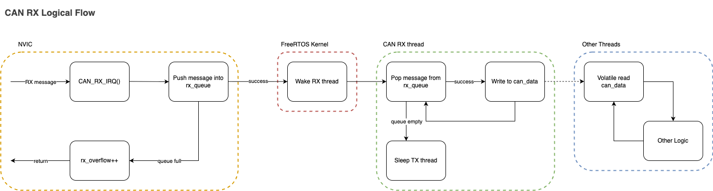
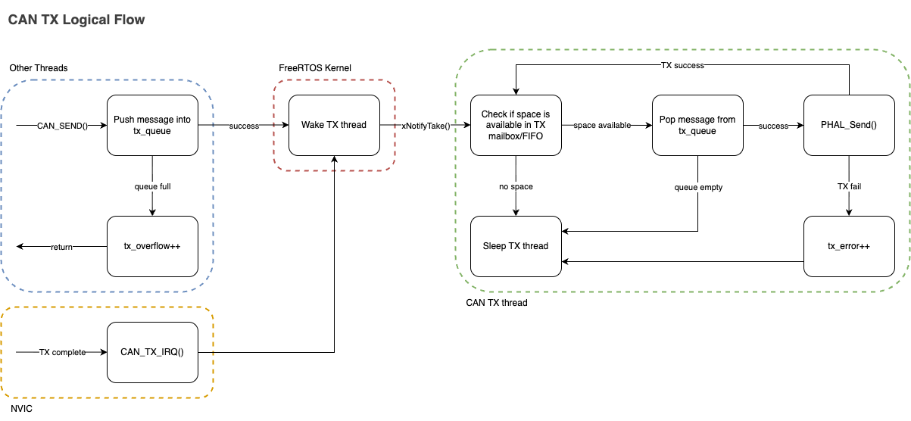
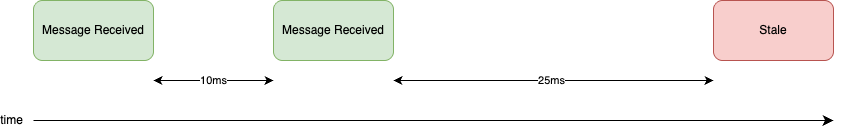

# PER CAN Library
Standardized framework for CAN communication within PER vehicles.

- `generators/`: Python generation pipeline for CAN and fault artifacts.
- `firmware/common/can_library/generated/`: Generated CAN headers.
- `artifacts/superdbc/`: Generated SuperDBC definitions and schema, relative to the repository root.

**Core Files:**
- [`can_init.c`](source/can_init.c) / [`can_common.h`](can_common.h): Bus/peripheral initialization and `CAN_init()`.
- [`can_rx.c`](source/can_rx.c): CAN RX task and the shared `can_data` instance.
- [`can_tx.c`](source/can_tx.c): CAN TX task and per-peripheral software queues.
- [`can_codec.h`](can_codec.h): Signal packing and unpacking helpers.
- `firmware/cmake/can_library.cmake`: CMake integration and node library generation.

## Logic
The high-level logic flow of an RX is shown here:

> [!NOTE]
> The all RX IRQs push to the same queue rather than having separate queues per peripheral.

The high-level logic flow of a TX is shown here:

> [!NOTE]
> The actual implementation of the CAN TX task manages up to 3 separate hardware peripherals at once, each with its own software queue.

## Stale Detection
Periodic CAN messages are assigned a deadline of 2.5x their expected period. If a message is not received within the window, it's associated data is no longer valid.

## Usage
1. Define your CAN network in `generators/configs/`; the generator validates them with its Pydantic declaration models.
    1. Use STM32G474 peripherals `FDCAN1`, `FDCAN2`, or `FDCAN3`.
2. Add `can_node_<NODE_NAME>` to `LIBS` in your board's `add_firmware_component(...)` call (must match the uppercase node name from CMake).
3. Include the generated header for your node (e.g. `#include "can_library/generated/PDU.h"` / `#include "can_library/generated/<NODE_NAME>.h"`) in your `main.c`.
4. Call `CAN_init()` after setting up RCC and GPIO.
    - This function also handles the initalization of relevant hardware
5. Setup CAN tasks in your `main.c` using `DEFINE_CAN_TASKS()` and `START_CAN_TASKS()`.
    - `START_CAN_TASKS()` enables the CAN IRQs

The most recent rx'd data is available in the `can_data` struct, which is updated by the CAN RX task.
Sending CAN messages is done via the generated `CAN_SEND_<message_name>()` functions, which enqueue messages to be sent by the CAN TX task.
