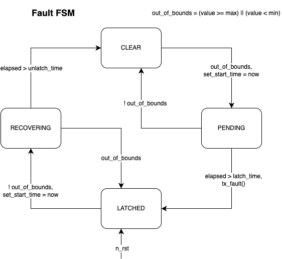

# PER Fault Library
The `faults_common` module implements the **FIDR (Fault Isolation, Detection, and Recovery)** system. It manages the lifecycle of system-wide faults using a robust Finite State Machine (FSM) to prevent flickering and ensure deterministic fault handling.

Fault declarations live in `generators/configs/`. The generator writes `fault_data.c` and `fault_data.h` to this module’s `generated/` directory.

## Usage
- `update_fault(fault_id_t fault_id, float value)`: Called by the owner node to feed sensor/status data into the FSM.
- `fault_library_periodic()`: Tally active faults and call `tx_fault_sync()`, which broadcasts the node-specific `<node>_fault_sync` CAN message.
- `is_latched(fault_id_t fault_id)`: Check if a specific fault is active.
- `is_clear(fault_id_t fault_id)`: Check if a specific fault is clear.

> [!NOTE]
> Each node is assigned a specific range of faults (`MY_FAULT_START` to `MY_FAULT_END`).
> Only the "owner" node can update the state of these faults, ensuring a single source of truth.
