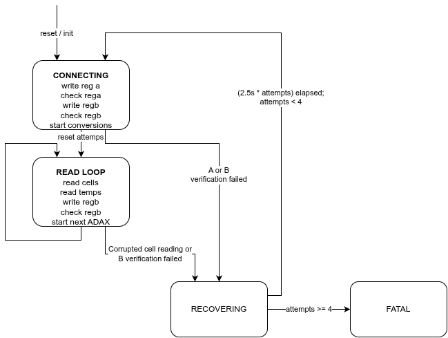

# ADBMS(6380)

Provides a high-level interface for managing `ADBMS6380` battery management chips
in a single-direction daisy chain configuration.
It handles communication, configuration, measurement collection, and balancing
for multi-module battery packs, supporting cell voltage, thermistor, and GPIO readings
as well as error detection via PEC checks.

## Usage

### Initialization

1. Define a global `adbms_bms_t` struct:
   ```c
   adbms_bms_t g_bms = {0};
   ```

2. Configure your SPI peripheral and GPIOs.
Note that the driver expects manual control of the CS line
(`nss_sw` must be false in the SPI config).

3. Initialize the driver in `main` (after GPIO setup):
   ```c
   ADBMS_init(&g_bms, &bms_spi_config);
   ```

### Periodic Operation

Call the periodic function regularly:
```c
void g_bms_periodic(void) {
    ADBMS_periodic(&g_bms, MIN_V_FOR_BALANCE, MIN_DELTA_FOR_BALANCE);
}
```

This updates cell voltage, thermistor readings, and error flags
(and all the aggregate statistics) in the `adbms_bms_t g_bms` struct.

#### For example

```c
RTOS_DEFINE_TASK(g_bms_periodic, 200, TASK_PRIORITY_HIGH, 2048);

int main(void) {
    // ... GPIO and SPI initialization ...

    ADBMS_init(&g_bms, &bms_spi_config);

    // Create periodic thread
    RTOS_START_TASK(g_bms_periodic);

    // ... rest of main ...
    vTaskStartScheduler();
}
```

BMS task should have high priority to ensure timely updates of measurements and
so that SPI communication is not delayed/interrupted.


### Accessing Measurements

After each periodic call, measurements, statistics, and status can be accessed via the `ADBMS_` getters:
- `ADBMS_get_cell_voltage(&g_bms, module_idx, cell_idx)`: Per-module cell voltage in volts
- `ADBMS_is_cell_discharging(&g_bms, module_idx, cell_idx)`: Whether a cell is actively discharging (balancing)
- `ADBMS_get_cell_temp(&g_bms, module_idx, cell_therm_idx)`: Per-module cell thermistor temperature in Celsius (`0 .. ADBMS_CELL_THERMS_PER_MODULE - 1`)
- `ADBMS_get_board_temp(&g_bms, module_idx, board_therm_idx)`: Per-module onboard PCB thermistor temperature in Celsius (`0 .. ADBMS_BOARD_THERMS_PER_MODULE - 1`)
- `ADBMS_get_min/max/avg/sum_voltage(&g_bms)`: Pack-level cell voltage statistics
- `ADBMS_get_min/max/avg_cell_temp(&g_bms)`: Pack-level cell thermistor temperature statistics
- `ADBMS_get_min/max/avg_board_temp(&g_bms)`: Pack-level onboard PCB temperature statistics
- `ADBMS_get_state(&g_bms)`: Current `adbms_state_t` (connecting, read loop, recovering, fatal)
- Error flags:
	- `ADBMS_get_cell_voltage_pec_err(&g_bms, cmd_idx)` and `ADBMS_get_gpio_voltage_pec_err(&g_bms, cmd_idx)`: PEC error flags for cell and GPIO voltage read commands. In the case of a PEC error during reading cell or GPIO voltages (which require multiple read commands), only the specific command that failed will have its PEC error flag set and the rest of the voltages for successful commands will still be updated/valid and the pack-level statistics will be updated based on the new valid readings and the old readings for the failed commands.
	- Internal register mismatch and PEC flags also also saved in `g_bms.dev`

### Controlling the Balancing

- To enable or disable BMS balancing, call `ADBMS_set_balancing_enabled` before the next periodic call:
```c
ADBMS_set_balancing_enabled(&g_bms, true); // or false to disable balancing
```
The driver will handle the rest (setting the appropriate bits in the REGB register of each chip based on the cell voltages and the configured thresholds).

#### Balancing algorithm

The balancing algorithm is a simple threshold-based approach:
- If the minimum cell voltage in the pack exceeds `MIN_V_FOR_BALANCE` (defined in ABOX)
- And the difference between a cell voltage and the minimum cell voltage is greater than `MIN_DELTA_FOR_BALANCE` (also defined in ABOX)
- Then the discharge (balancing) for that cell will be enabled by setting the appropriate bit in the REGB register of the chip that contains that cell.
- Otherwise, discharge for that cell will be disabled.

## File Structure

- `adbms_config.h`: Shared pack topology configuration
- `adbms.c` / `adbms.h`: High-level flow driver logic, pack statistics, balancing, state management
- `adbms6380.c` / `adbms6380.h`: Low-level chip-specific protocol, SPI framing, register packing, multi-command readout, thermistor conversion
- `commands.h`: `static constexpr` command definitions for ADBMS6380.
- `pec.c` / `pec.h`: PEC (CRC15/CRC10) calculations

## State Machine



## Notes

- The driver is designed for FreeRTOS-based systems with a 1000Hz tick rate (1ms tick period).
  - Its primary reliance on FreeRTOS comes from the use of `RTOS_delay_ms(ADBMS6380_WAKE_DELAY_MS)` in the wake-up sequence.
- All communication is performed via SPI, with manual CS control for timing.
	- The SPI transfer is a blocking DMA operation and should not fail (returns void)
- Error handling: flags for PEC checksum failures and register read-back mismatches
- Make sure the `ADBMS_MODULE_COUNT` constant in `adbms_config.h` matches the actual number of modules and chips in your daisy chain configuration!!
    - Additionally, if you are bench testing, make sure corruption checks are disabled (comment them out)
- There is a reliance on lookup tables (`cell_thermistor_lut` and `board_thermistor_lut`) from `../thermistor/thermistor.h`

## Authors

- Primary: Millan Kumar
- Supporting:
	- Irving Wang
	- Ronak Jain
	- Shriya Balu
	- Sebastian Arthur
