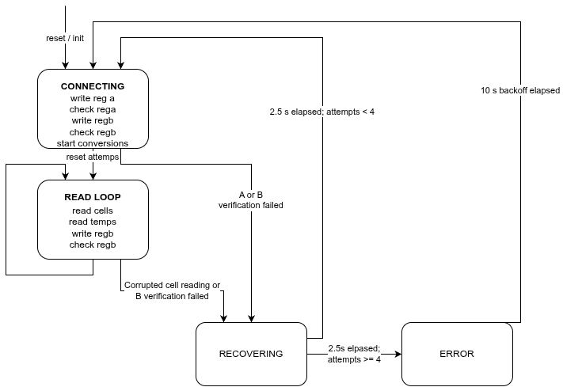

# ADBMS(6380)

Provides a high-level interface for managing `ADBMS6380` battery management modules
in a single-direction daisy chain configuration.
It handles communication, configuration, and measurement collection, and balancing
for multi-module battery packs, supporting cell voltage, thermistor, GPIO readings
as well as error detection via PEC checks.

## Usage

### Initialization

1. Define a global `adbms_bms_t` struct and a TX buffer:
   ```c
   adbms_bms_t g_bms = {0};
   uint8_t g_bms_tx_buf[ADBMS_SPI_TX_BUFFER_SIZE] = {0};
   ```

2. Configure your SPI peripheral and GPIOs.
Note that the driver expects manual control of the CS line
(`nss_sw` must be false in the SPI config).

3. Initialize the driver in main (after GPIO and SPI setup):
   ```c
   adbms_init(&g_bms, &bms_spi_config, g_bms_tx_buf);
   ```

### Periodic Operation

Call the periodic function regularly:
```c
void g_bms_periodic() {
	adbms_periodic(&g_bms, MIN_V_FOR_BALANCE, MIN_DELTA_FOR_BALANCE);
}
```

This updates cell voltage, thermistor readings, and error flags
(and all the aggregate statistics) in the `adbms_bms_t g_bms` struct.

### State Machine

`adbms_periodic()` implements a 4-state machine. Each state is entered once per
tick, and its body runs a complete straight-line sequence in one call, written
inline in the state's switch case. Any failure mid-sequence jumps the state to `RECOVERING`.
`RECOVERING` and `ERROR` are non-blocking waits spanning multiple ticks.

| State | Action |
|-------|--------|
| `ADBMS_STATE_CONNECTING` | Run the full connect sequence (below); on success → `READ_LOOP`, any failure → `RECOVERING` |
| `ADBMS_STATE_READ_LOOP` | Run one full measure/balance cycle (below); on success stay in `READ_LOOP`, any failure → `RECOVERING` |
| `ADBMS_STATE_RECOVERING` | Non-blocking wait for a full chip sleep-wake cycle (2.5 s) |
| `ADBMS_STATE_ERROR` | Non-latching backoff after repeated failed recovery (10 s, SDC pin pulled) |

Connect sequence (runs in order inside `CONNECTING`, early-exiting on the first failure):
1. Write REGA configuration to all modules
2. Read REGA back and verify
3. Write REGB configuration to all modules
4. Read REGB back and verify
5. Reset `recovery_attempts`
6. Start continuous cell voltage conversions (ADCV)

Measure/balance cycle (runs in order inside `READ_LOOP`, early-exiting on the first failure):
1. Read cell voltages and sanity-check the range
2. Read thermistor voltages and convert to temperature
3. Compute per-cell discharge flags for balancing
4. Write REGB with the new discharge bits
5. Read REGB back and verify

Recovery: each completed `RECOVERING` cycle (2.5 s) increments
`recovery_attempts` (clamped at `ADBMS_RECOVERY_MAX_ATTEMPTS` = 4). After 4
consecutive failed recovery cycles the driver enters `ERROR`; after the 10 s
error backoff the counter is reset and it returns to `CONNECTING`.
`recovery_attempts` is also reset by a successful connect sequence. In steady
state the driver runs one full measure/balance cycle per tick (200 ms).

#### For example

```c
RTOS_DEFINE_TASK(g_bms_periodic, 200, TASK_PRIORITY_HIGH, 2048);

int main() {
	// ... GPIO and SPI initialization ...

	adbms_init(&g_bms, &bms_spi_config, g_bms_tx_buf);

	// Create periodic thread
    RTOS_START_TASK(g_bms_periodic);

	// ... rest of main ...
    vTaskStartScheduler();
}
```

BMS task should have high priority to ensure timely updates of measurements and
so that SPI communication is not delayed/interrupted.


### Accessing Measurements

After each periodic call, values can be read from the `adbms_bms_t` struct:
- `g_bms.modules[i].cell_voltages`: Per-module cell voltages
	- `ADBMS6380_CELL_COUNT` (16) per module
- `g_bms.modules[i].therms_temps`: Per-module thermistor temperatures in Celsius
	- `ADBMS6380_GPIO_COUNT` (10) per module
	- Temps calculated with the following flow:
		1. GPIO voltage
		2. R2 in the thermistor divider
			- R1 = `ADBMS_GPIO_R1` = 10kOhms
			- Vin = VREG2 = `ADBMS_GPIO_VIN` = 3.0v
		3. Temperature via lerp of datasheet values
- `g_bms.min_voltage`/`g_bms.max_voltage`/`g_bms.avg_voltage`/`g_bms.sum_voltage`: Pack-level cell voltage statistics
- `g_bms.min_therm_temp`/`g_bms.max_therm_temp`/`g_bms.avg_therm_temp`:  Pack-level thermistor temperature statistics
- Error flags:
	- `g_bms.err_rega_mismatch`: REGA register mismatch error
		- The configuration we tried to write did not match the reading. Indicates a potential communication issue or misconfiguration.
		- Same for REGB.
		- There is also a flag in each module struct for per-module REGA and REGB mismatch errors (`g_bms.modules[i].err_rega_mismatch` and `g_bms.modules[i].err_regb_mismatch`)
			- Indicate if there was a mismatch for that specific module (as opposed to the pack-level flags which indicate if there was a mismatch for any module in the pack).
	- `g_bms.err_*_pec`: PEC error flags for various operations (register reads, cell voltage reads, GPIO voltage reads). Indicates potential communication issues or data corruption. In the case of a PEC error during reading cell or GPIO voltages (which require multiple read commands), only the specific command that failed will have its PEC error flag set and the rest of the voltages for successful commands will still be updated/valid and the pack-level statistics will be updated based on the new valid readings and the old readings for the failed commands.

### Controlling the Balancing
- To enable or disable BMS balancing, simply set the `is_balancing_enabled` field in the `adbms_bms_t` struct before the next periodic call:
```c
g_bms.is_balancing_enabled = true; // or false to disable balancing
```
The driver will handle the rest (setting the appropriate bits in the REGB register of each module based on the cell voltages and the configured thresholds).

#### Balancing algorithim

The balancing algorithm is a simple threshold-based approach:
- If the minimum cell voltage in the pack exceeds `MIN_V_FOR_BALANCE` (defined in ABOX)
- And the difference between a cell voltage and the minimum cell voltage is greater than `MIN_DELTA_FOR_BALANCE` (also defined in ABOX)
- Then the discharge (balancing) for that cell will be enabled by setting the appropriate bit in the REGB register of the module that contains that cell.
- Otherwise, discharge for that cell will be disabled.

## File Structure

- `adbms.c` / `adbms.h`: High-level driver logic and state management.
- `adbms6380.c` / `adbms6380.h`: Low-level chip-specific functions and command encoding.
- `commands.c` / `commands.h`: Command definitions for ADBMS6380.
- `pec.c` / `pec.h`: PEC (CRC) calculation utilities.

## State Machine



## Notes

- The driver is designed for FreeRTOS-based systems with a 1000Hz tick rate (1ms tick period).
  - Its primary reliance on FreeRTOS comes from the use of `RTOS_delay_ms(ADBMS6380_WAKE_DELAY_MS)` in the wake-up sequence.
- All communication is performed via SPI, with manual CS control for timing.
	- The SPI transfer is a blocking DMA operation and should not fail (returns void)
- Error handling: flags for PEC checksum failures and register read-back mismatches
- Make sure the `ADBMS_MODULE_COUNT` constant matches the actual number of modules in your daisy chain configuration!!
- There is a hidden reliance on a global variable defined in `../thermistor/thermistor.c` (and `extern`ed in the header): `thermistor_lut`

## Authors

- Primary: Millan Kumar
- Supporting:
	- Irving Wang
	- Ronak Jain
	- Shriya Balu
	- Sebastian Arthur
