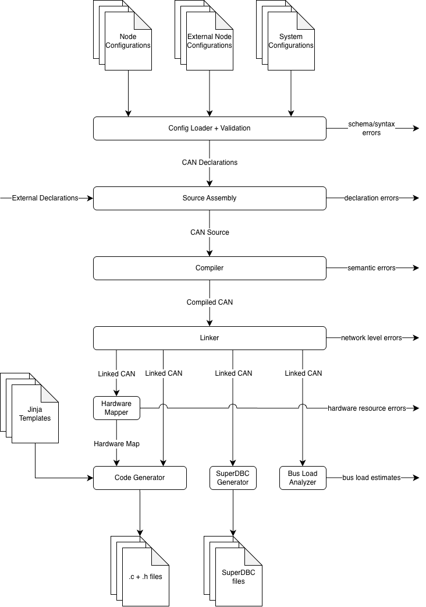

# CANpiler

## Diagnostics

`diagnosticsgen` adds CAN messages for task stats, CPU usage, and task names.

`configs/system/diagnostics.json` maps node names to their preferred diagnostics
buses in the `nodes` object. Both CAN messages and the diagnostics header use
this configuration.
If the node doesn't use that bus, the generator uses its only configured bus
instead. If there are several buses to choose from, it reports an error.
Update this file when adding a node or changing its preferred bus.
